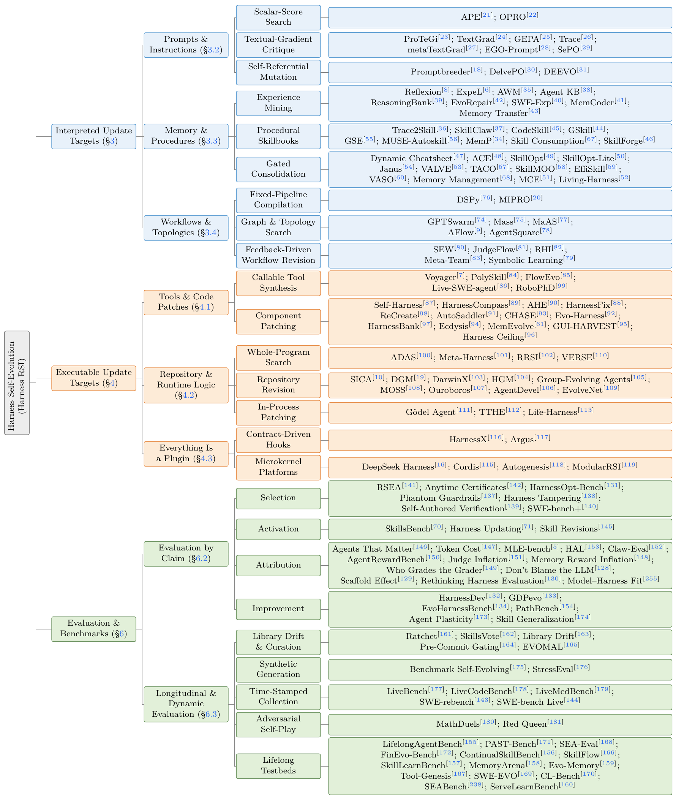
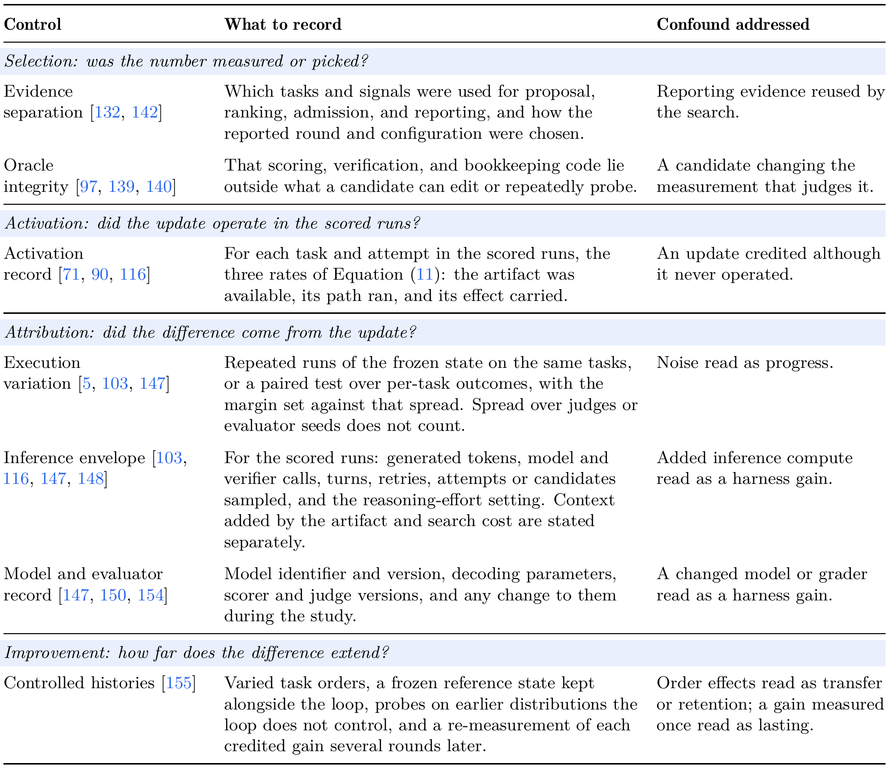

<div align="center">

<h1>Harness Self-Evolution: Theory, <br>Algorithms, Evaluation, Applications, and Impact</h1>
<p align="center"><strong><a href="https://github.com/zgcagi/Harness-RSI/blob/main/paper/harness-self-evolution.pdf">📄 Full version · 66 pages</a></strong></p>

[Self-Evolving Agent Harness · arXiv](https://arxiv.org/pdf/2610.18813) · [Project Page](https://zgcagi.github.io/Harness-RSI/) · [Reading List](#interpreted) · [Citation](#citation) · [中文版](README_zh.md) · [](https://awesome.re)

<p align="center">Chuyang Wei<sup>1,3</sup>, Haoxiang Guan<sup>1,3</sup>, Minghang Zhu<sup>1</sup>, Kexin Zhou<sup>1,3</sup>, Jiyan He<sup>1,2</sup>, Xiren Zhou<sup>3</sup>, Huanhuan Chen<sup>3</sup>, Yifei Shen<sup>1,2,†</sup></p>

<p align="center">
  <sup>1</sup> Zhongguancun Academy &nbsp;·&nbsp; <sup>2</sup> Zhongguancun Institute of Artificial Intelligence<br>
  <sup>3</sup> University of Science and Technology of China &nbsp;·&nbsp; <sup>†</sup> Corresponding author
</p>

[](assets/banner.png)

</div>

Companion materials for our survey of how execution experience becomes persistent harness state under a fixed base model. The survey covers update mechanisms, evolutionary search, continual PAC learning, evaluation, applications, and societal impact.

**PDF downloads:** [Full report · 66 pages](paper/harness-self-evolution.pdf) · [Short paper · 18 pages](paper/self-evolving-agent-harness.pdf).

Updated 1 November 2026: both PDFs include the compositional-safety reference. [Revision details](docs/manuscript-sync.md#compositional-safety-update--1-november-2026).

## Reading Guide

**Background**　[Related Surveys](#related-surveys) · [Definition](#definition) · [Taxonomy](#taxonomy) · [Precursors](#precursors)

**Literature**　[Interpreted](#interpreted) · [Executable](#executable) · [Theory](#theory) · [Evaluation](#evaluation)

**Resources**　[Applications & Outlook](#applications) · [Reported Evidence](#evidence) · [Contributing](#contributing) · [Citation](#citation)

<a id="related-surveys"></a>

## Related Surveys

- **A Survey of Self-Evolving Agents** `TMLR'26` — organizes self-evolution by what, when, how, and where to evolve. [[paper]](https://arxiv.org/abs/2507.21046)
- **A Comprehensive Survey of Self-Evolving AI Agents** `arXiv'25` — organizes methods by optimizer feedback. [[paper]](https://arxiv.org/abs/2508.07407) [[list]](https://github.com/EvoAgentX/Awesome-Self-Evolving-Agents)
- **Externalization in LLM Agents** `arXiv'26` — unified review of memory, skills, protocols, and harness engineering. [[paper]](https://arxiv.org/abs/2604.08224)
- **Code as Agent Harness** `arXiv'26` — organizes by the role of code in the agent loop. [[paper]](https://arxiv.org/abs/2605.18747) [[list]](https://github.com/YennNing/Awesome-Code-as-Agent-Harness-Papers)
- **Recursive Self-Improvement in AI** `arXiv'26` — from bounded self-refinement to autonomous research loops, organized by loop closure. [[paper]](https://arxiv.org/abs/2607.07663)
- **Self-Improvements in Modern Agentic Systems** `arXiv'26` — separates model and scaffold updates under frozen parameters and discusses independent evaluation and component controls. [[paper]](https://arxiv.org/abs/2607.13104) [[list]](https://github.com/selfimproving-agent/awesome-Self-Improving-Agents)
- **Self-Evolving Coding Agents** `arXiv'26` — distinguishes proposal eligibility, runtime activation, and admission, and discusses component controls under a common budget. [[paper]](https://arxiv.org/abs/2608.03392)

<a id="definition"></a>

## Definition

A **harness** $H$ is the software and configuration that governs how a model $M$ operates in an environment $E$. It includes tools, context construction, memory, and execution control. The final evaluator $J$ scores a trajectory and stays outside the candidate’s editable surface; internal critics and provisional verifiers may belong to the mutable harness.

$$
\tau \sim \mathrm{Run}(M,H,E), \qquad y=J(\tau)
$$

Harness self-evolution uses a batch of trajectories $\mathcal{B}_k$ to revise the state used by later runs:

$$
H_{k+1}=\mathrm{Update}(H_k,\mathcal{B}_k)
$$

The update mechanism remains available for further revisions, and an accepted state is saved and loaded by a later run. Rejected candidates leave the harness unchanged. The analysis holds $M$ fixed; systems that also train weights are read here for their harness-side changes. Offline optimizers and mechanisms with limited persistence are marked in the entries.

Self-evolution is the process of updating persistent harness state; self-improvement is a beneficial change established through [evaluation](#evaluation). Harness RSI is the conventional short name used throughout this resource.

[](assets/overview.png)

<details>
<summary>Harness components (paper §2)</summary>

Runtime responsibilities and mechanisms. An implementation may combine or omit components.

[](assets/harness-components.png)

</details>

<a id="taxonomy"></a>

## Taxonomy

**Interpreted updates** revise content read by a fixed host; **executable updates** revise the implementations it invokes. Evaluation forms a separate branch, while theory cuts across update targets.

[](assets/taxonomy.png)

Reference numbers follow the manuscript; source links appear in the reading list below. See also the [taxonomy data](data/taxonomy.json).

<a id="precursors"></a>

## Precursors

- **Speculations Concerning the First Ultraintelligent Machine** `Adv. Computers'65` — frames recursive improvement as a machine designing a better successor to itself. [[paper]](https://doi.org/10.1016/S0065-2458%2808%2960418-0)
- **EURISKO** `Artif. Intell.'83` — learned heuristics, including heuristics that modify other heuristics, shape later search. [[paper]](https://doi.org/10.1016/S0004-3702%2883%2980005-8)
- **Gödel Machines** `arXiv'03` — a self-rewrite executes only after the system proves the rewrite improves expected utility. [[paper]](https://arxiv.org/abs/cs/0309048)

<a id="interpreted"></a>

## 1. Interpreted Update Targets

These methods revise instructions, memory, or coordination specifications read by fixed components. Entries note offline optimization and task-local adaptation where applicable.

### 1.1 Prompts & Instructions

#### Scalar-Score Search

*Use candidate scores to propose and select prompt revisions.*

- **APE** `ICLR'23` — proposes instructions from input–output demonstrations and keeps the highest-scoring candidate. [[paper]](https://openreview.net/forum?id=92gvk82DE-) [[project]](https://sites.google.com/view/automatic-prompt-engineer)
- **OPRO** `ICLR'24` — feeds earlier instructions and scores to an optimizer model that proposes the next candidate. [[paper]](https://openreview.net/forum?id=Bb4VGOWELI) [[code]](https://github.com/google-deepmind/opro)

#### Textual-Gradient Critique

*Translate errors, critiques, or execution traces into edits to text parameters.*

- **ProTeGi** `EMNLP'23` — converts task errors into natural-language "gradients" and beam-searches over the edited prompts. [[paper]](https://aclanthology.org/2023.emnlp-main.494/)
- **TextGrad** `Nature'25` — backpropagates textual critiques through a graph of LLM calls to edit any text variable in the system. [[paper]](https://doi.org/10.1038/s41586-025-08661-4)
- **GEPA** `ICLR'26 Oral` — uses execution-trace reflection to revise prompts and Pareto selection to retain candidates. [[paper]](https://openreview.net/forum?id=RQm2KQTM5r)
- **Trace** `NeurIPS'24` — treats the execution trace as a computation graph and generates edits from rich feedback through a generative optimizer. [[paper]](https://arxiv.org/abs/2406.16218) [[project]](https://microsoft.github.io/Trace/)
- **metaTextGrad** `arXiv'25` — optimizes the optimizer's own prompts, accepting an update only when a validation split improves. [[paper]](https://arxiv.org/abs/2505.18524)
- **EGO-Prompt** `arXiv'25` — co-adapts the prompt and a semantic causal graph for domain deployments. [[paper]](https://arxiv.org/abs/2510.21148)
- **SePO** `arXiv'26` — rewrites persistent system prompts using accumulated task feedback. [[paper]](https://arxiv.org/abs/2606.04465) [[code]](https://github.com/taowangcheng/SePO)

#### Self-Referential Mutation

*Search over the instructions that generate later mutations.*

- **Promptbreeder** `ICML'24` — co-evolves task prompts and the mutation prompts that generate them. [[paper]](https://proceedings.mlr.press/v235/fernando24a.html)
- **DelvePO** `arXiv'25` — decouples prompt components and steers mutation along identified directions. [[paper]](https://arxiv.org/abs/2510.18257)
- **DEEVO** `arXiv'25` — evolves instructions through structured debates, ranking candidates by Elo tournament. [[paper]](https://arxiv.org/abs/2506.00178)

### 1.2 Memory & Reusable Procedures

#### Experience Mining

*Distill execution trajectories into knowledge retrieved by later runs.*

- **Reflexion** `NeurIPS'23` — stores verbal self-reflection on a failure and reloads it for another attempt at the same task. [[paper]](http://papers.nips.cc/paper_files/paper/2023/hash/1b44b878bb782e6954cd888628510e90-Abstract-Conference.html)
- **ExpeL** `AAAI'24` — extracts cross-task insights from a training pool of trajectories, with add/edit/upvote/downvote curation. [[paper]](https://doi.org/10.1609/aaai.v38i17.29936)
- **AWM** `ICML'25` — induces recurring sub-goal workflows from trajectories, offline from a training split or online from the task stream. [[paper]](https://proceedings.mlr.press/v267/wang25bx.html)
- **Agent KB** `arXiv'25` — a cross-domain experience base whose top-k retrieved items are injected into later runs. [[paper]](https://arxiv.org/abs/2507.06229)
- **ReasoningBank** `ICLR'26` — consolidates reasoning strategies from successes and failures into a bank injected into the system instruction. [[paper]](https://openreview.net/forum?id=jL7fwchScm)
- **EvoRepair** `arXiv'26` — accumulates, scores, and reuses vulnerability-repair experience across long-horizon repairs. [[paper]](https://arxiv.org/abs/2605.30105)
- **SWE-Exp** `arXiv'25` — distills issue-resolution experience from prior search trajectories into a bank queried on new issues. [[paper]](https://arxiv.org/abs/2507.23361) [[code]](https://github.com/YerbaPage/SWE-Exp)
- **MemCoder** `arXiv'26` — structured memory of repository knowledge and repair outcomes that grows alongside the codebase. [[paper]](https://arxiv.org/abs/2603.13258)
- **Memory Transfer** `arXiv'26` — measures how memories formed in one domain transfer to another, across four memory formats. [[paper]](https://arxiv.org/abs/2604.14004)

#### Procedural Skillbooks

*Store an explicit procedure that can guide later tasks.*

- **Trace2Skill** `arXiv'26` — distills execution lessons into skill patches and aggregates them into reusable skill documents; validation-based patch selection is a separate experiment. [[paper]](https://arxiv.org/abs/2603.25158)
- **SkillClaw** `arXiv'26` — an agentic evolver whose validator admits a candidate skill only if it beats the deployed pool on validation tasks. [[paper]](https://arxiv.org/abs/2604.08377)
- **CodeSkill** `arXiv'26` — learns self-evolving coding skills through preparatory passes that build the bank before deployment. [[paper]](https://arxiv.org/abs/2605.25430)
- **GSkill** `ACM AIAS'26` — automatically learns `SKILL.md` files for coding agents from prior runs. [[paper]](https://doi.org/10.1145/3786335.3813196)
- **GSE** `arXiv'26` — learns globally reusable skills gated by local and replay-driven validation under one-project-held-out splits. [[paper]](https://arxiv.org/abs/2608.06153)
- **MUSE-Autoskill** `arXiv'26` — couples skill creation, memory, and management, registering a skill only once it passes its own generated tests. [[paper]](https://arxiv.org/abs/2605.27366)
- **MemP** `ACL'26 Findings` — distills procedural memory from trajectories and compares update strategies and abstraction granularities. [[paper]](https://doi.org/10.18653/v1/2026.findings-acl.866)
- **Skill Consumption** `arXiv'26` — examines how generated skills affect downstream behavior, including changes to default strategies and explicit use. [[paper]](https://arxiv.org/abs/2605.23899)
- **SkillForge** `SIGIR'26 Industry` — learns reusable skill documents from execution experience and reserves a later temporal partition for reporting. [[paper]](https://doi.org/10.1145/3805712.3808466)

#### Gated Consolidation

*Revise, compress, or replace stored content through a validation or maintenance rule.*

- **Dynamic Cheatsheet** `EACL'26` — maintains an adaptive memo of strategies curated at test time. [[paper]](https://aclanthology.org/2026.eacl-long.333/)
- **ACE** `ICLR'26` — grows and consolidates an evolving context playbook through incremental delta updates instead of rewrites. [[paper]](https://openreview.net/forum?id=eC4ygDs02R)
- **SkillOpt** `arXiv'26` — evaluates a revised skill set on validation before it replaces the active library. [[paper]](https://arxiv.org/abs/2605.23904)
- **SkillOpt-Lite** `arXiv'26` — combines a validation deadband with compilation and smoke tests to admit skill edits at lower cost. [[paper]](https://arxiv.org/abs/2607.03451) [[code]](https://github.com/EvolvingLMMs-Lab/SkillOpt-Lite)
- **Janus** `arXiv'26` — wraps an updater and compares old and candidate memories on coverage, boundary, and fresh tasks when a proposal deviates from the recent update direction. [[paper]](https://arxiv.org/abs/2606.31121)
- **VALVE** `arXiv'26` — admits skill revisions through paired comparisons on a validation panel and tracks drawdown over a long task stream. [[paper]](https://arxiv.org/abs/2609.32990)
- **TACO** `arXiv'26` — compresses observations for terminal agents through a write-back gate and a reward-free retention stopping rule. [[paper]](https://arxiv.org/abs/2604.19572) [[code]](https://github.com/multimodal-art-projection/TACO)
- **SkillMOO** `arXiv'26` — uses NSGA-II ranking to select skill combinations under competing objectives. [[paper]](https://arxiv.org/abs/2604.09297)
- **EffiSkill** `arXiv'26` — mines efficiency skills from verified code pairs, ranking candidates on a public split and reporting on a private one. [[paper]](https://arxiv.org/abs/2603.27850)
- **VASO** `arXiv'26` — formally verifiable skills: each plan is model-checked against the skill's specification before it may run. [[paper]](https://arxiv.org/abs/2606.05395)
- **Memory Management** `ACL'26` — empirical study of how retention, deletion, and retrieval rules change task outcomes, with a similarity-based adherence measure. [[paper]](https://aclanthology.org/2026.acl-long.27/)
- **MCE** `ICML'26` — applies history-informed (1+1) evolution to skills with agentic crossover and a validation archive. [[paper]](https://icml.cc/virtual/2026/poster/64296)
- **Living-Harness** `arXiv'26` — an interactive-agent evolver that consolidates retrieved memory into a reusable graph across cycles. [[paper]](https://arxiv.org/abs/2607.26598) [[code]](https://github.com/anotherbricki/Living-Harness)

### 1.3 Workflows & Topologies

#### Fixed-Pipeline Compilation

*Optimize prompts and demonstrations while keeping the pipeline structure fixed.*

- **DSPy** `ICLR'24` — compiles declarative LM pipelines, optimizing prompts and demonstrations while control flow stays fixed. [[paper]](https://openreview.net/forum?id=PFS4ffN9Yx) [[code]](https://github.com/stanfordnlp/dspy)
- **MIPRO** `EMNLP'24` — jointly optimizes instructions and demonstrations across the stages of a multi-stage LM program. [[paper]](https://aclanthology.org/2024.emnlp-main.525/) [[project]](https://dspy.ai)

#### Graph & Topology Search

*Search over connections and coordination among fixed operators.*

- **GPTSwarm** `ICML'24` — makes edges between fixed operations learnable and optimizes the resulting communication graph. [[paper]](https://proceedings.mlr.press/v235/zhuge24a.html) [[code]](https://github.com/metauto-ai/gptswarm)
- **Mass** `ICLR'26` — jointly searches agent prompts and communication topologies over predefined multi-agent blocks. [[paper]](https://proceedings.iclr.cc/paper_files/paper/2026/hash/1ab4e0e8f35078109bc78d7b465d306f-Abstract-Conference.html)
- **MaAS** `ICML'25` — samples query-dependent architectures from an agentic supernet over predefined operators. [[paper]](https://proceedings.mlr.press/v267/zhang25bi.html)
- **AFlow** `ICLR'25` — serializes workflows as operator-composing code and searches structure and prompts over it; the operators themselves stay fixed. [[paper]](https://openreview.net/forum?id=z5uVAKwmjf) [[code]](https://github.com/FoundationAgents/AFlow)
- **AgentSquare** `ICLR'25` — searches module compositions in a modular design space while also generating new module implementations. [[paper]](https://openreview.net/forum?id=mPdmDYIQ7f) [[code]](https://github.com/tsinghua-fib-lab/AgentSquare)

#### Feedback-Driven Workflow Revision

*Use execution feedback to revise the workflow specification.*

- **SEW** `arXiv'25` — jointly mutates prompts and topology while comparing alternative workflow representations. [[paper]](https://arxiv.org/abs/2505.18646)
- **JudgeFlow** `arXiv'26` — uses block-level judge diagnoses to revise sequence, loop, and conditional blocks. [[paper]](https://arxiv.org/abs/2601.07477)
- **RHI** `arXiv'26` — applies pairwise feedback to roles, instructions, communication contracts, and interaction hops within one task episode. [[paper]](https://arxiv.org/abs/2607.15524)
- **Meta-Team** `arXiv'26` — carries experience across tasks to update a reusable scaffold of agent prompts, teammate profiles, collaboration notes, and shared coordination rules. [[paper]](https://arxiv.org/abs/2605.29790)
- **Symbolic Learning** `AI Open'25` — jointly revises pipeline structure, prompts, and tools through back-propagated language loss. [[paper]](https://doi.org/10.1016/j.aiopen.2025.11.004)

<a id="executable"></a>

## 2. Executable Update Targets

These methods revise tools, component implementations, control programs, or plugins invoked by the host.

### 2.1 Tools & Code Patches

#### Callable Tool Synthesis

*Generate reusable programs exposed through a tool interface.*

- **Voyager** `TMLR'24` — turns self-verified programs into a growing skill library retrieved and composed in later tasks. [[paper]](https://openreview.net/forum?id=ehfRiF0R3a) [[project]](https://voyager.minedojo.org/)
- **PolySkill** `arXiv'25` — induces polymorphic skill abstractions so a learned skill generalizes past its originating site. [[paper]](https://arxiv.org/abs/2510.15863) [[code]](https://github.com/simonucl/PolySkill)
- **FlowEvo** `arXiv'26` — compiles a successful workflow into a validated callable artifact in a persistent skill bank, then either executes it or describes it to workflow generation. [[paper]](https://arxiv.org/abs/2607.21596) [[code]](https://github.com/DEFENSE-SEU/FlowEvo)
- **Live-SWE-agent** `arXiv'25` — synthesizes Bash and Python tools during a task; the tools are discarded with its container. [[paper]](https://arxiv.org/abs/2511.13646)
- **RoboPhD** `arXiv'26` — co-evolves a deterministic Python analysis tool with model-readable SQL instructions, then ships the pair without its evolutionary infrastructure. [[paper]](https://arxiv.org/abs/2601.01126)

#### Evidence-Grounded Component Patching

*Modify a declared executable component while the enclosing executor stays fixed.*

- **Self-Harness** `arXiv'26` — proposes edits from the incumbent and admits candidates that do not regress on either split and improve on at least one. [[paper]](https://arxiv.org/abs/2606.09498) [[code]](https://github.com/qzzqzzb/Self-Harness)
- **HarnessCompass** `arXiv'26` — optimizes harness components separately and combines them into candidate configurations. [[paper]](https://arxiv.org/abs/2608.01918)
- **AHE** `arXiv'26` — uses submit-guard and shell traces to diagnose component edits and supports file-level rollback. [[paper]](https://arxiv.org/abs/2604.25850)
- **HarnessFix** `arXiv'26` — diagnoses harness faults from failed trajectories and admits a repair only through a validation-set assessment. [[paper]](https://arxiv.org/abs/2606.06324)
- **ReCreate** `ACL'26` — edits role, process, tool, and memory components at text and code level using a small development set. [[paper]](https://aclanthology.org/2026.acl-long.1432/)
- **AutoSaddler** `arXiv'26` — retains patches that improve a minibatch, selects on development data, and reports on a group-disjoint test split. [[paper]](https://arxiv.org/abs/2608.23041)
- **CHASE** `arXiv'26` — tests proposed patches against protocol transformations designed to invalidate their apparent gains. [[paper]](https://arxiv.org/abs/2609.18366)
- **Evo-Harness** `arXiv'26` — compiles accumulated context into harness-level skills along an online stream, matching fail→pass traces to skill content. [[paper]](https://arxiv.org/abs/2608.15071) [[code]](https://github.com/A-EVO-Lab/a-evolve)
- **HarnessBank** `arXiv'26` — archives component patches by semantic descriptor, checks activation beacons during screening, and keeps evaluation code in an immutable kernel. [[paper]](https://arxiv.org/abs/2607.13683)
- **Ecdysis** `arXiv'26` — trains runtime harnesses with promotion on a training objective, then scores the frozen harness on a held-out split. [[paper]](https://arxiv.org/abs/2609.11677)
- **MemEvolve** `arXiv'25` — rewrites the encode, store, retrieve, and manage implementations behind a fixed memory-provider interface. [[paper]](https://arxiv.org/abs/2512.18746)
- **GUI-HARVEST** `arXiv'26` — turns recurring failures from repeated GUI executions into bounded source edits with stated behavioral predictions. [[paper]](https://arxiv.org/abs/2610.00948)
- **Harness Ceiling** `arXiv'26` — compares harness edits on long-horizon planning tasks to identify failures that remain for weight training. [[paper]](https://arxiv.org/abs/2610.11655)

### 2.2 Repository & Runtime Logic

#### Whole-Control-Program Search

*Search over the control program; VERSE also revises the optimizer that proposes it.*

- **ADAS** `ICLR'25` — a fixed meta-agent writes new agent `forward` implementations and keeps evaluated candidates in an archive. [[paper]](https://openreview.net/forum?id=t9U3LW7JVX) [[project]](https://shengranhu.com/ADAS)
- **Meta-Harness** `COLM'26` — uses an external coding agent to generate complete harness programs from earlier candidates’ source, scores, and traces. [[paper]](https://arxiv.org/abs/2603.28052)
- **RRSI** `arXiv'26` — regularizes program search using edit budgets, leakage checks, and noise-adjusted admission thresholds. [[paper]](https://arxiv.org/abs/2609.24972) [[code]](https://github.com/google-research/rrsi)
- **VERSE** `arXiv'26` — revises both the executor harness and the optimizer’s prompts, tools, hooks, and notes under execution checks. [[paper]](https://arxiv.org/abs/2610.02616)

#### Repository Revision

*Edit a versioned harness implementation and retain candidates for further evolution.*

- **SICA** `arXiv'25` — lets the best archived agent revise its own multi-file Python codebase, including tools, subagents, and control flow. [[paper]](https://arxiv.org/abs/2504.15228)
- **DGM** `ICLR'26` — branches repository variants into an open-ended archive, with parent selection over performance and novelty. [[paper]](https://openreview.net/forum?id=pUpzQZTvGY)
- **DarwinX** `arXiv'26` — evolves repository-level harness candidates through selection, mutation, and recombination. [[paper]](https://arxiv.org/abs/2608.07545)
- **HGM** `arXiv'25` — approximates clade-level productivity and allocates lineage-expansion and evaluation budgets by Thompson sampling. [[paper]](https://arxiv.org/abs/2510.21614) [[code]](https://github.com/metauto-ai/HGM)
- **Group-Evolving Agents** `arXiv'26` — lets selected parents share code patches, tools, and execution experience before producing framework-level patches. [[paper]](https://arxiv.org/abs/2602.04837)
- **MOSS** `arXiv'26` — rewrites routing, hooks, state management, and dispatch code, then swaps the container behind a health check plus human authorization. [[paper]](https://arxiv.org/abs/2605.22794) [[code]](https://github.com/hkgai-official/Moss)
- **Ouroboros** `arXiv'26` — evolves its own core through reviewed commits, with run manifests, seed attestation, and public per-task traces. [[paper]](https://arxiv.org/abs/2608.08311)
- **AgentDevel** `arXiv'26` — uses versioned diffs and release-candidate regression tests, recording which tasks each update fixes or breaks. [[paper]](https://arxiv.org/abs/2601.04620)
- **EvolveNet** `arXiv'26` — combines harness edits across clients and validates merged patches before broadcasting shared state. [[paper]](https://arxiv.org/abs/2608.04968)

#### In-Process Patching

*Apply changes to a running process; persistence depends on the system’s save and reload mechanism.*

- **Gödel Agent** `ACL'25` — monkey-patches decision methods, action spaces, and modification routines in Python memory; edits last for the process lifetime. [[paper]](https://aclanthology.org/2025.acl-long.1354/)
- **TTHE** `arXiv'26` — evolves executable harness programs from traces at test time and carries the selected program into subsequent inputs. [[paper]](https://arxiv.org/abs/2607.08124)
- **Life-Harness** `arXiv'26` — adapts environment contracts, action realization, and trajectory regulation together, then freezes the runtime interface for evaluation. [[paper]](https://arxiv.org/abs/2605.22166) [[code]](https://github.com/Tianshi-Xu/Life-Harness)

### 2.3 Everything Is a Plugin

#### Contract-Driven Hooks

*Bind updates to hooks with explicit interfaces and admission checks.*

- **HarnessX** `arXiv'26` — checks hook types, singleton constraints, and smoke tests before acceptance; each edit declares an expected trace feature. Replay, novelty, and structural checks do not guarantee non-decreasing task scores. [[paper]](https://arxiv.org/abs/2606.14249)
- **Argus** `arXiv'26` — exposes skills through a general agent runtime and evolves them along long task streams. [[paper]](https://arxiv.org/abs/2608.05144)

#### Microkernel Platforms

*Keep a small host fixed and expose replaceable components through plugin interfaces.*

- **DeepSeek Harness** `Product'26` — provides a Cordis-based runtime with declared dependencies, checkpointing, and replay; the product page reports no empirical self-evolution evaluation. [[page]](https://www.deepseek.com/harness/en/)
- **Autogenesis** `arXiv'26` — a self-evolving agent protocol with an explicit propose–evaluate–commit cycle over lineage and versioning. [[paper]](https://arxiv.org/abs/2604.15034) [[code]](https://github.com/DVampire/Autogenesis)
- **ModularRSI** `arXiv'26` — evolves modules behind a composer and admits updates through a reward-blind gate on externally curated tasks. [[paper]](https://arxiv.org/abs/2609.14857)
- **Cordis / Spatiotemporal Composability** `arXiv'26` — the formal calculus behind that kernel; self-evolving harnesses are stated as future work. [[paper]](https://arxiv.org/abs/2608.25512)

<a id="theory"></a>

## 3. Theory

The paper develops two perspectives: optimization and generalization. Many reviewed methods search discrete harness state without gradients; scores support selection while traces and critiques guide proposals. Evolutionary paradigms describe shared search structures, and continual PAC analysis studies generalization, retention, and candidate admission.

### 3.1 Evolutionary Paradigms

The paper maps variation, selection, archive retention, and budget allocation onto EA paradigms. A method may appear in several rows; each mapping states its scope.

[](assets/evolutionary-paradigms.png)

### 3.2 PAC Learning & Stability

The continual PAC analysis separates sensitivity to training samples, retention of earlier capabilities, and admission of new candidates. It assumes independent exogenous task draws, task losses in $[0,1]$, and a fixed model and evaluator.

For at most $K$ candidates in each of $T$ rounds, compare each candidate with the incumbent on $m$ fresh tasks independent of its construction:

$$
\widehat{\Delta}_k(H') + \sqrt{\frac{2\ln(KT/\delta)}{m}} < 0
$$

Here $\widehat{\Delta}$ is candidate loss minus incumbent loss. Under the stated assumptions, this gate gives joint confidence $1-\delta$ for accepted candidates on their round’s task mixture. It applies to the candidate actually tested, including any merged edits. Repeated rollouts reduce execution noise but do not add independent tasks.

#### Stability & Retention

- **Learnability, Stability and Uniform Convergence** `JMLR'10` — relates an algorithm's sensitivity to individual observations to its generalization gap. [[paper]](https://www.jmlr.org/papers/v11/shalev-shwartz10a.html)
- **Memory Bounds for Continual Learning** `FOCS'22` — lower bounds on the memory a continual learner needs, motivating generalization and retention as one joint question. [[paper]](https://arxiv.org/abs/2204.10830)

#### Confidence-Gated Admission

- **Hoeffding Bounds** `JASA'63` — bounds deviations of bounded empirical losses for paired candidate admission. [[paper]](https://doi.org/10.1080/01621459.1963.10500830)
- **Selection Overfitting** `JMLR'10` — analyzes overfitting in model selection and its bias in reported performance. [[paper]](https://jmlr.org/papers/v11/cawley10a.html)
- **The Reusable Holdout** `Science'15` — preserves validity of a holdout reused across adaptive, data-dependent decisions. [[paper]](https://doi.org/10.1126/science.aaa9375) · [[companion]](https://arxiv.org/abs/1506.02629)
- **SkillForge** `SIGIR'26 Industry` — learns reusable skill documents from execution experience and reserves a later temporal partition for reporting. [[paper]](https://doi.org/10.1145/3805712.3808466)

#### Self-Improvement Limits

- **Harness Evolution as Learning** `arXiv'26` — approximation, generalization, and optimization limits of self-improving personal agents. [[paper]](https://arxiv.org/abs/2609.36892)
- **A Theory of Reliable Self-Evolution** `arXiv'26` — derives adoption conditions whose ceiling depends on verification and evaluation cost. [[paper]](https://arxiv.org/abs/2609.08175)

### 3.3 Background Statistical & Optimization Tools

- **The Ladder** `ICML'15` — a leaderboard mechanism that stays reliable under repeated adaptive submissions. [[paper]](https://proceedings.mlr.press/v37/blum15.html)
- **Train Faster, Generalize Better** `ICML'16` — stability of SGD as a route to generalization bounds. [[paper]](https://proceedings.mlr.press/v48/hardt16.html)
- **PAC-Bayes for Prompts** `arXiv'23` — prompt engineering may not require rethinking generalization. [[paper]](https://arxiv.org/abs/2310.03957)
- **ZOPO** `arXiv'24` — localized zeroth-order prompt optimization. [[paper]](https://arxiv.org/abs/2403.02993)
- **Statistical Limits** `TMLR'26` — statistical limits of self-improving agents. [[paper]](https://arxiv.org/abs/2510.04399)
- **AdaEvolve** `arXiv'26` — adaptive LLM-driven zeroth-order optimization. [[paper]](https://arxiv.org/abs/2602.20133)
- **GAMBLe** `arXiv'26` — an analytical framework for AI-driven research systems. [[paper]](https://arxiv.org/abs/2606.02863)
- **Mutation Without Variation** `GECCO'26` — convergence dynamics in LLM-driven program evolution. [[paper]](https://arxiv.org/abs/2606.05408) [[code]](https://github.com/can-gurkan/lmca)
- **What Fits Doesn't Overfit** `arXiv'26` — compression and generalization in ML research agents. [[paper]](https://arxiv.org/abs/2606.11045)
- **IMABO** `arXiv'26` — bandit hyperparameter optimization at inference time. [[paper]](https://arxiv.org/abs/2609.01335) [[code]](https://github.com/Tiime-Software/IMABO)

<a id="evaluation"></a>

## 4. Evaluation & Benchmarks

The evaluation framework connects **Selection, Activation, Attribution, and Improvement** to the evidence supporting each reported comparison.

[](assets/claims.png)

Activation distinguishes an artifact being **available**, its changed path being **reached**, and its effect being **carried** into subsequent execution. See the [criteria](docs/evidence-criteria.md) for evidentiary requirements and coverage.

The Improvement criterion records how reporting tasks relate to those that formed the update. Selection and Attribution assess the reliability and source of the observed gain.

### 4.1 Claim-Specific Evidence

#### Selection & Oracle Integrity

*Separate reporting evidence from the update process and protect the scorer from candidate edits.*

- **RSEA** `arXiv'26` — assigns separate data to proposal, admission, and reporting. [[paper]](https://arxiv.org/abs/2606.28374)
- **Anytime Certificates** `arXiv'26` — anytime-valid certificates for repeated, data-dependent admission decisions. [[paper]](https://arxiv.org/abs/2607.00871)
- **HarnessOpt-Bench** `arXiv'26` — keeps its test partition out of reach for the whole search, with the boundary enforced by the runtime, and meters the resources the target agent spends. [[paper]](https://arxiv.org/abs/2608.06301)
- **Phantom Guardrails** `arXiv'26` — documents self-improving harnesses that fix failures which never occurred, the patch grounded in no observed execution. [[paper]](https://arxiv.org/abs/2607.13083)
- **Harness Tampering** `arXiv'26` — examines candidates that modify verification logic rather than the behavior under test. [[paper]](https://arxiv.org/abs/2609.00069)
- **Self-Authored Verification** `arXiv'26` — finds self-written checks unreliable as admission evidence in heuristic self-improving agents. [[paper]](https://arxiv.org/abs/2607.24300)
- **SWE-bench+** `arXiv'24` — documents solution leakage and weak assertions that corrupt promotion and reporting together. [[paper]](https://arxiv.org/abs/2410.06992)

#### Runtime Activation

*Record whether the accepted artifact operated in the runs that produced the result.*

- **SkillsBench** `arXiv'26` — records whether task-provided skills are read or referenced, across diverse tasks. [[paper]](https://arxiv.org/abs/2602.12670)
- **Harness Updating ≠ Harness Benefit** `arXiv'26` — measures skill loading separately from trajectory adherence to identify updates that are available but not followed. [[paper]](https://arxiv.org/abs/2605.30621) [[code]](https://github.com/A-EVO-Lab/a-evolve)
- **Skill Revisions** `arXiv'26` — tests whether revisions to a skill change coding-agent behavior when the skill is loaded on demand. [[paper]](https://arxiv.org/abs/2610.04832)

#### Attribution Controls

*Separate the effect of the update from execution variation, inference compute, and evaluator changes.*

- **Agents That Matter** `TMLR'25` — shows agent comparisons confound capability with cost, and asks for cost-controlled evaluation. [[paper]](https://arxiv.org/abs/2407.01502)
- **Token Cost** `arXiv'26` — analyzes and predicts token consumption in agent runs. [[paper]](https://arxiv.org/abs/2604.22750)
- **MLE-bench** `ICLR'25` — ML-engineering tasks with repeated runs and an explicit compute envelope. [[paper]](https://arxiv.org/abs/2410.07095)
- **HAL** `ICLR'26` — standardized run records, model snapshots, and cost accounting as shared evaluation infrastructure. [[paper]](https://proceedings.iclr.cc/paper_files/paper/2026/file/a0928f924a344aaebbb7f6cd8d56e34c-Paper-Conference.pdf)
- **Claw-Eval** `arXiv'26` — scores trajectories and repeats trials to estimate execution variation. [[paper]](https://arxiv.org/abs/2604.06132)
- **AgentRewardBench** `COLM'25` — meta-evaluates automatic judges of web-agent trajectories against expert annotation. [[paper]](https://arxiv.org/abs/2504.08942) [[project]](https://agent-reward-bench.github.io)
- **Judge Inflation** `arXiv'24` — documents spontaneous reward hacking in iterative self-refinement. [[paper]](https://arxiv.org/abs/2407.04549)
- **Memory Reward Inflation** `arXiv'26` — shows stored memory can inflate the reported reward rather than improve the behavior. [[paper]](https://arxiv.org/abs/2608.00017)
- **Who Grades the Grader** `arXiv'26` — examines evaluator drift when metrics and skills evolve together. [[paper]](https://arxiv.org/abs/2607.12790) [[code]](https://github.com/amazon-science/Self-Evolving-Agents-Double-Ratchet)
- **Don't Blame the LLM** `arXiv'26` — attributes measured coding-agent differences to harness evolution rather than to the model. [[paper]](https://arxiv.org/abs/2607.03691)
- **Scaffold Effect** `arXiv'26` — treats harness choice as a hidden variable in coding-agent comparisons. [[paper]](https://arxiv.org/abs/2607.22585)
- **Rethinking Harness Evaluation** `arXiv'26` — examines protocol confounds in reported harness-evolution gains. [[paper]](https://arxiv.org/abs/2607.12227)
- **Model–Harness Fit** `arXiv'26` — compares model–harness combinations across agent tasks to identify interaction effects. [[paper]](https://arxiv.org/abs/2610.00917)

#### Generalization & Retention

*Test on held-out tasks, new settings, or earlier distributions.*

- **HarnessDev** `arXiv'26` — separates harness *creation* from iterative *evolution*, reporting capability, cost, and held-out transfer. [[paper]](https://arxiv.org/abs/2609.01437)
- **GDPevo** `arXiv'26` — evaluates evolved harnesses on held-out business tasks constructed by recombining rules from training tasks. [[paper]](https://arxiv.org/abs/2608.03764) [[code]](https://github.com/Prism-Shadow/GDPevo)
- **EvoHarnessBench** `arXiv'26` — grows the harness an agent is given and measures whether earlier competence is retained as capabilities are added. [[paper]](https://arxiv.org/abs/2609.04280)
- **PATH-Bench** `arXiv'26` — path-dependent evaluation: deliberately varied task order and retained frozen reference histories. [[paper]](https://arxiv.org/abs/2608.01149)
- **Agent Plasticity** `arXiv'26` — measures how execution experience translates into held-out gains and examines failures to reuse artifacts. [[paper]](https://arxiv.org/abs/2610.08902)
- **Skill Generalization** `arXiv'26` — compares evolved skills on training and held-out tasks to measure how much improvement transfers. [[paper]](https://arxiv.org/abs/2609.39148)

### 4.2 Longitudinal & Dynamic Evidence

<details>
<summary>Controls for successive updates (paper §6.3)</summary>

Successive updates require state and evaluator records, execution variation, inference budgets, and historical task performance. The table connects each control with its confound.

[](assets/evaluation-controls.png)

</details>

#### Active-Set Integrity

*Track which stored artifacts remain reachable and used after later updates.*

- **Ratchet** `arXiv'26` — asks how reliable an LLM judge must be before a skill may be retired. [[paper]](https://arxiv.org/abs/2605.22148) [[code]](https://github.com/amazon-science/Self-Evolving-Agents-Ratchet)
- **SkillsVote** `arXiv'26` — lifecycle governance of skills across collection, recommendation, and voting-based curation. [[paper]](https://arxiv.org/abs/2605.18401)
- **Library Drift** `arXiv'26` — diagnoses and fixes silent drift in a growing self-evolving skill library. [[paper]](https://arxiv.org/abs/2605.19576) [[code]](https://github.com/amazon-science/Self-Evolving-Agents-Ratchet)
- **Pre-Commit Gating** `arXiv'26` — checks proposed skill changes before commit to prevent contamination. [[paper]](https://arxiv.org/abs/2608.05810)
- **EVOMAL** `arXiv'26` — documents self-poisoning in self-evolving coding agents. [[paper]](https://arxiv.org/abs/2608.25776)

#### Synthesized Boundary Tasks

*Construct new tasks while recording overlap with the feedback used to form updates.*

- **Benchmark Self-Evolving** `arXiv'24` — a multi-agent framework that derives new instances from existing ones for dynamic evaluation. [[paper]](https://arxiv.org/abs/2402.11443) [[code]](https://github.com/NanshineLoong/Self-Evolving-Benchmark)
- **StressEval** `arXiv'26` — failure-driven dynamic benchmarking that generates instances from diagnosed failures. [[paper]](https://arxiv.org/abs/2605.01939)

#### Temporal Streams

*Use tasks released after a cutoff and account for changes in difficulty and content.*

- **LiveBench** `ICLR'25 Spotlight` — contamination-limited benchmark refreshed from post-cutoff sources with objective ground truth. [[paper]](https://arxiv.org/abs/2406.19314)
- **LiveCodeBench** `arXiv'24` — time-stamped competitive-programming problems collected after a cutoff. [[paper]](https://arxiv.org/abs/2403.07974) [[project]](https://livecodebench.github.io/)
- **LiveMedBench** `arXiv'26` — contamination-free medical benchmark with automated refresh. [[paper]](https://arxiv.org/abs/2602.10367)
- **SWE-rebench** `arXiv'25` — automated pipeline for task collection and decontaminated evaluation. [[paper]](https://arxiv.org/abs/2505.20411) [[project]](https://swe-rebench.com)
- **SWE-bench Live** `arXiv'25` — continuously refreshed SWE-bench built from freshly merged issues. [[paper]](https://arxiv.org/abs/2505.23419) [[project]](https://swe-bench-live.github.io/)

#### Adversarial Play

*Report changes to the agent, task generator, and evaluator separately.*

- **MathDuels** `COLM'26` — a self-play benchmark that grows with the participant pool. [[paper]](https://arxiv.org/abs/2604.21916)
- **Red Queen Gödel Machine** `arXiv'26` — co-evolves agents and their evaluators in one loop. [[paper]](https://arxiv.org/abs/2606.26294)

#### Lifelong Testbeds

*Evaluate sequential tasks together with the state carried between them.*

- **LifelongAgentBench** `arXiv'25` — evaluates agents as lifelong learners over skill-dependent task sequences. [[paper]](https://arxiv.org/abs/2505.11942) [[project]](https://caixd-220529.github.io/LifelongAgentBench/)
- **PAST-Bench** `arXiv'26` — benchmarks RSI foundations in personal agents, comparing persistence enabled against disabled. [[paper]](https://arxiv.org/abs/2608.04003) [[code]](https://github.com/Gen-Verse/PAST-Bench)
- **SEA-Eval** `arXiv'26` — evaluates self-evolving agents beyond isolated episodes. [[paper]](https://arxiv.org/abs/2604.08988)
- **FinEvo-Bench** `arXiv'26` — longitudinal professional-finance benchmark with matched persistence-on/off conditions. [[paper]](https://arxiv.org/abs/2608.06144)
- **ContinualSkillBench** `arXiv'26` — measures skill development over a continual task stream. [[paper]](https://arxiv.org/abs/2608.03874)
- **SkillFlow** `arXiv'26` — benchmarks lifelong skill discovery and evolution. [[paper]](https://arxiv.org/abs/2604.17308)
- **SkillLearnBench** `arXiv'26` — benchmarks continual-learning methods for agent skill generation. [[paper]](https://arxiv.org/abs/2604.20087) [[code]](https://github.com/cxcscmu/SkillLearnBench)
- **MemoryArena** `arXiv'26` — interdependent multi-session tasks in which earlier writes affect later work. [[paper]](https://arxiv.org/abs/2602.16313)
- **Evo-Memory** `arXiv'25` — benchmarks test-time learning with self-evolving memory. [[paper]](https://arxiv.org/abs/2511.20857)
- **Tool-Genesis** `arXiv'26` — task-driven tool-creation benchmark for self-evolving agents. [[paper]](https://arxiv.org/abs/2603.05578)
- **SWE-EVO** `arXiv'25` — long-horizon software-evolution scenarios for coding agents. [[paper]](https://arxiv.org/abs/2512.18470)
- **CL-Bench** `arXiv'26` — frontier systems in real-world stateful continual-learning settings. [[paper]](https://arxiv.org/abs/2606.05661)
- **SEABench** `arXiv'26` — benchmarks endogenous misalignment in self-evolving agents. [[paper]](https://arxiv.org/abs/2609.35596)
- **ServeLearnBench** `arXiv'26` — streams environments with changing undisclosed rules to evaluate learning from serving experience. [[paper]](https://arxiv.org/abs/2610.07792)

<a id="evidence"></a>

## 5. Reported Evidence

<!-- evidence-summary:start -->

Evidence for the four claims across 93 primary reported comparisons; 2 methods without empirical evaluation are excluded.

[](assets/reported-evidence.png)

The most common evidence profile meets Selection and task distance, with partial Activation and Attribution: reports often evaluate on held-out tasks, but less often confirm that accepted updates execute in scored runs or separate their effects from run variation and extra inference compute.

See the [full results](docs/reported-evidence.md) for comparisons, judgments, and sources, and the [criteria](docs/evidence-criteria.md) for their definitions.

<!-- evidence-summary:end -->

<a id="applications"></a>

## 6. Applications and Outlook

The survey examines personal assistance and developer workspaces, enterprise automation, scientific discovery, robotics, and public or clinical services. Harness state can preserve preferences, shared procedures, research know-how, and executable skills. These settings differ in what an update changes, how far it travels, and how its effects can be checked.

Persistent and shareable artifacts also affect work and learning, control over accumulated knowledge, privacy, security, and institutional accountability. Open questions include model–harness–environment co-evolution, optimization over heterogeneous artifacts, compositional program contracts, reusable state, dynamic evaluation, and authorization boundaries. See the [application map](assets/applications.png) and [societal-impact map](assets/social-impact.png), with the full discussion in Sections 7–9 of the [paper](paper/harness-self-evolution.pdf).

Examples include runtime capability bindings in [DSH Everything](https://github.com/yshenaw/dsh-everything/tree/dade643bb09c49d290340ee01f3a00dd20bf37fb), clinically prioritized tool admission in [MedRSI](https://arxiv.org/abs/2609.24838), and practice-environment design in [EnvHarness](https://arxiv.org/abs/2608.19880).

[Compositional Safety Failures in Harness Evolution](https://arxiv.org/abs/2609.33123) identifies 43 pairwise and 18 irreducible three-way failures among updates that individually pass safety and utility checks. Its hypergraph-guided runtime monitor checks activated interactions before actions take effect, reducing observed violations while leaving coverage of unseen interactions unresolved.

The short paper presents cases on model–harness pairing, plugin reuse, and distributed execution.

<a id="contributing"></a>

## Contributing

See [CONTRIBUTING.md](CONTRIBUTING.md) for adding papers, correcting evidence, and rebuilding the site. Keep English and Chinese entries synchronized.

Bibliographies: [full report](paper/harness-self-evolution-references.bib) · [short paper](paper/self-evolving-agent-harness-references.bib).

<a id="citation"></a>

## Citation

Please cite the version you use:

- Full version: [Harness Self-Evolution: Theory, Algorithms, Evaluation, Applications, and Impact](https://github.com/zgcagi/Harness-RSI/blob/main/paper/harness-self-evolution.pdf).
- arXiv paper: [Self-Evolving Agent Harness](https://arxiv.org/pdf/2610.18813).

```bibtex
@misc{wei2026harnessrsi,
  title  = {{Harness Self-Evolution: Theory, Algorithms, Evaluation,
             Applications, and Impact}},
  author = {Wei, Chuyang and Guan, Haoxiang and Zhu, Minghang and
            Zhou, Kexin and He, Jiyan and Zhou, Xiren and
            Chen, Huanhuan and Shen, Yifei},
  year   = {2026},
  url    = {https://github.com/zgcagi/Harness-RSI/blob/main/paper/harness-self-evolution.pdf}
}

@misc{wei2026selfevolvingagentharness,
  title         = {{Self-Evolving Agent Harness}},
  author        = {Wei, Chuyang and Guan, Haoxiang and Zhu, Minghang and
                   Zhou, Kexin and He, Jiyan and Zhou, Xiren and
                   Chen, Huanhuan and Shen, Yifei},
  year          = {2026},
  eprint        = {2610.18813},
  archivePrefix = {arXiv},
  primaryClass  = {cs.AI},
  url           = {https://arxiv.org/pdf/2610.18813}
}
```

---

<sub>Released under [CC BY 4.0](LICENSE). Listed works retain their respective licenses.</sub>
