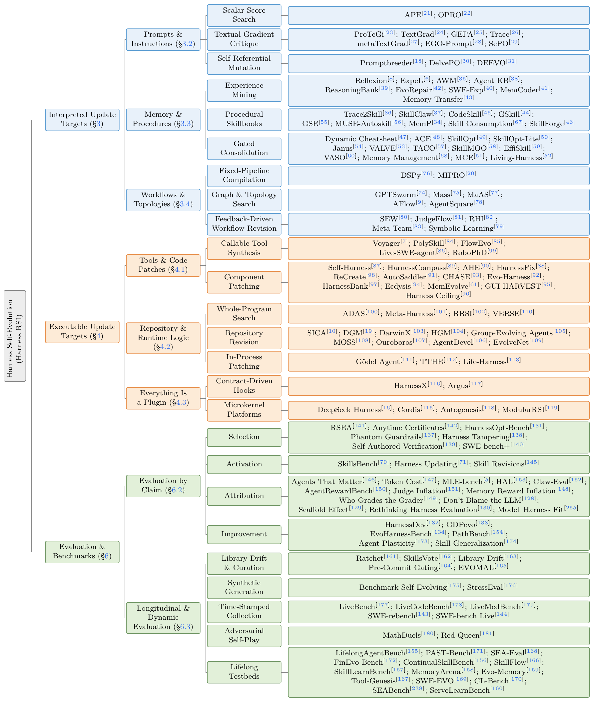
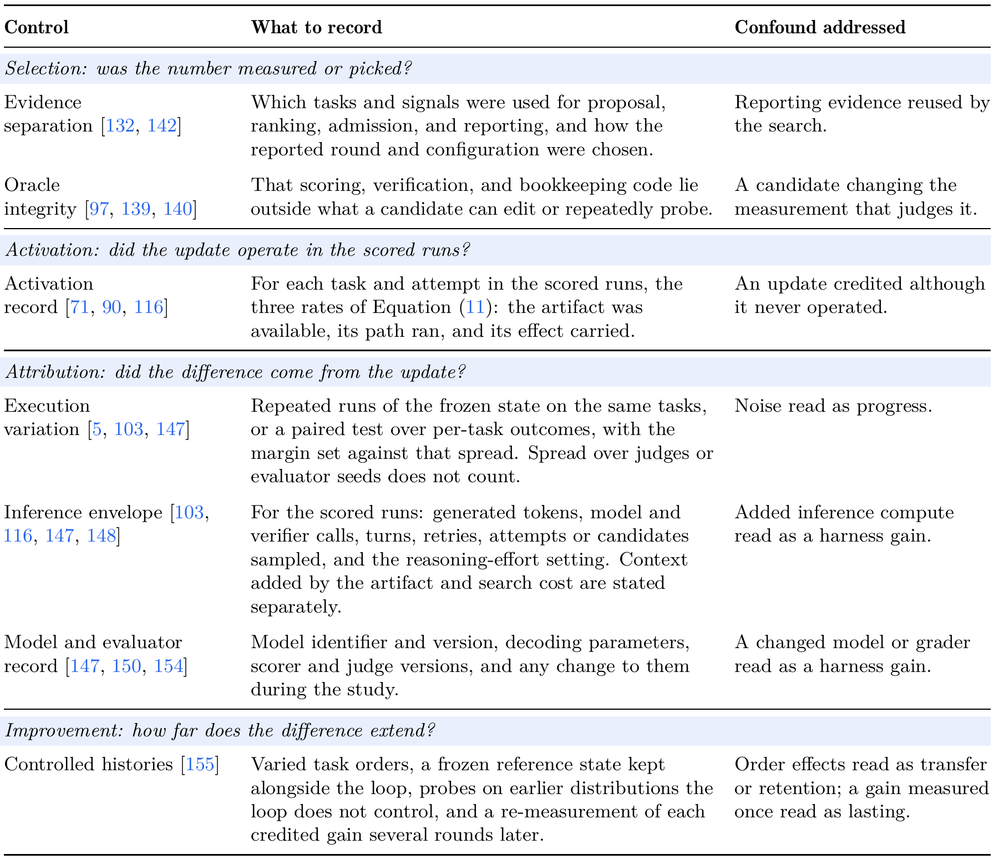

<div align="center">

<h1>Harness Self-Evolution</h1>
<p><strong>Theory, Algorithms, Evaluation, Applications, and Impact</strong></p>

<p align="center">Chuyang Wei<sup>1,3</sup>, Haoxiang Guan<sup>1,3</sup>, Minghang Zhu<sup>1</sup>, Kexin Zhou<sup>1,3</sup>, Jiyan He<sup>1,2</sup>, Xiren Zhou<sup>3</sup>, Huanhuan Chen<sup>3</sup>, Yifei Shen<sup>1,2,†</sup></p>

<p align="center">
  <sup>1</sup> Zhongguancun Academy &nbsp;·&nbsp; <sup>2</sup> Zhongguancun Institute of Artificial Intelligence<br>
  <sup>3</sup> University of Science and Technology of China &nbsp;·&nbsp; <sup>†</sup> Corresponding author
</p>

[完整版 · GitHub PDF](https://github.com/zgcagi/Harness-RSI/blob/main/paper/harness-self-evolution.pdf) · [Self-Evolving Agent Harness · arXiv](https://arxiv.org/pdf/2610.18813) · [项目主页](https://zgcagi.github.io/Harness-RSI/) · [文献清单](#interpreted) · [实证证据](#evidence) · [引用](#citation) · [English](README.md)

[](https://awesome.re)

[](assets/banner.png)

</div>

本综述研究固定基础模型下，执行经验如何转化为持续保留的 harness 状态，涵盖更新机制、演化搜索、continual PAC 学习、评测、应用与社会影响。

**PDF 下载：**[完整报告 · 66 页](paper/harness-self-evolution.pdf) · [短版论文 · 18 页](paper/self-evolving-agent-harness.pdf)。

2026 年 11 月 1 日更新：两份 PDF 均已加入组合安全文献引用。[修订记录](docs/manuscript-sync.md#compositional-safety-update--1-november-2026)。

## 阅读导航

**背景**　[相关综述](#related-surveys) · [定义](#definition) · [分类](#taxonomy) · [前置工作](#precursors)

**文献**　[Interpreted](#interpreted) · [Executable](#executable) · [Theory](#theory) · [Evaluation](#evaluation)

**资料**　[应用与展望](#applications) · [实证证据](#evidence) · [贡献与维护](#contributing) · [引用](#citation)

<a id="related-surveys"></a>

## 相关综述

- **A Survey of Self-Evolving Agents** `TMLR'26`：按演化什么、何时演化、如何演化、在哪里演化来组织。 [[paper]](https://arxiv.org/abs/2507.21046)
- **A Comprehensive Survey of Self-Evolving AI Agents** `arXiv'25`：按优化器反馈组织方法。 [[paper]](https://arxiv.org/abs/2508.07407) [[list]](https://github.com/EvoAgentX/Awesome-Self-Evolving-Agents)
- **Externalization in LLM Agents** `arXiv'26`：统一回顾记忆、技能、协议与 harness 工程。 [[paper]](https://arxiv.org/abs/2604.08224)
- **Code as Agent Harness** `arXiv'26`：按代码在 agent 循环中的角色组织。 [[paper]](https://arxiv.org/abs/2605.18747) [[list]](https://github.com/YennNing/Awesome-Code-as-Agent-Harness-Papers)
- **Recursive Self-Improvement in AI** `arXiv'26`：按更新过程的完整程度，组织从局部 self-refinement 到自主研究的方法。 [[paper]](https://arxiv.org/abs/2607.07663)
- **Self-Improvements in Modern Agentic Systems** `arXiv'26`：在参数冻结的前提下区分模型与 scaffold 更新，讨论独立评测与组件对照。 [[paper]](https://arxiv.org/abs/2607.13104) [[list]](https://github.com/selfimproving-agent/awesome-Self-Improving-Agents)
- **Self-Evolving Coding Agents** `arXiv'26`：区分候选资格、runtime activation 与准入，并讨论共同预算下的组件对照。 [[paper]](https://arxiv.org/abs/2608.03392)

<a id="definition"></a>

## 定义

**Harness** $H$ 是控制模型 $M$ 如何在环境 $E$ 中运行的软件与配置，包括工具、上下文构建、记忆和执行控制。最终 evaluator $J$ 对轨迹评分，候选更新不能修改它；内部 critic 和临时 verifier 可以属于可修改的 harness。

$$
\tau \sim \mathrm{Run}(M,H,E), \qquad y=J(\tau)
$$

Harness self-evolution 根据一批执行轨迹 $\mathcal{B}_k$，修订后续运行使用的状态：

$$
H_{k+1}=\mathrm{Update}(H_k,\mathcal{B}_k)
$$

更新机制需要保留，以便继续修订；采纳后的状态需要保存，并由后续运行实际加载。拒绝候选时沿用当前版本。分析固定模型 $M$；同时训练 weights 的系统按其 harness 更新部分讨论。离线优化器和持久性有限的方法在条目中注明。

Self-evolution 指持续更新 harness 状态的过程；self-improvement 指通过[评测](#evaluation)确认的有益变化。本文沿用 Harness RSI 这一领域简称。

[](assets/overview.png)

<details>
<summary>Harness 组件（论文 §2）</summary>

组件的运行职责与具体机制。实现可以合并或省略其中的组件。

[](assets/harness-components.png)

</details>

<a id="taxonomy"></a>

## 分类

**Interpreted updates** 修改固定 host 读取的内容；**Executable updates** 修改 host 调用的实现。评测方法单列一支，Theory 横跨更新对象。

[](assets/taxonomy.png)

图内引用编号沿用论文，原文链接见下方文献清单。另见[分类数据](data/taxonomy.json)。

<a id="precursors"></a>

## 前置工作

- **Speculations Concerning the First Ultraintelligent Machine** `Adv. Computers'65`：把递归改进表述为机器设计出比自己更好的后继者。 [[paper]](https://doi.org/10.1016/S0065-2458%2808%2960418-0)
- **EURISKO** `Artif. Intell.'83`：学到的启发式规则会影响后续搜索，其中包含修改其他启发式规则的规则。 [[paper]](https://doi.org/10.1016/S0004-3702%2883%2980005-8)
- **Gödel Machines** `arXiv'03`：只有在系统证明某次自我重写能提高期望效用之后，这次重写才被执行。 [[paper]](https://arxiv.org/abs/cs/0309048)

<a id="interpreted"></a>

## 1. Interpreted Update Targets

这类方法修改固定组件读取的指令、记忆或协作规则。离线优化与单任务适应的情形在条目中注明。

### 1.1 Prompts 与指令

#### 基于分数的搜索

*根据候选分数提出并选择 prompt 修订。*

- **APE** `ICLR'23`：从输入输出样例里采样候选指令，保留分数最高的那个。 [[paper]](https://openreview.net/forum?id=92gvk82DE-) [[project]](https://sites.google.com/view/automatic-prompt-engineer)
- **OPRO** `ICLR'24`：将历史指令及其分数提供给 optimizer model，由它提出下一条候选。 [[paper]](https://openreview.net/forum?id=Bb4VGOWELI) [[code]](https://github.com/google-deepmind/opro)

#### Textual-gradient 优化

*将错误、反馈或执行轨迹转成文本参数的修改建议。*

- **ProTeGi** `EMNLP'23`：把任务错误转成自然语言"梯度"，再对编辑后的提示做 beam search。 [[paper]](https://aclanthology.org/2023.emnlp-main.494/)
- **TextGrad** `Nature'25`：在模型调用组成的计算图上反向传播文本反馈，更新图中的文本变量。 [[paper]](https://doi.org/10.1038/s41586-025-08661-4)
- **GEPA** `ICLR'26 Oral`：根据执行轨迹反思修订 prompts，并通过 Pareto selection 保留候选。 [[paper]](https://openreview.net/forum?id=RQm2KQTM5r)
- **Trace** `NeurIPS'24`：将执行轨迹表示为计算图，由生成式优化器根据反馈提出修改。 [[paper]](https://arxiv.org/abs/2406.16218) [[project]](https://microsoft.github.io/Trace/)
- **metaTextGrad** `arXiv'25`：修订优化器自身的 prompts，仅在验证集表现改善时采纳更新。 [[paper]](https://arxiv.org/abs/2505.18524)
- **EGO-Prompt** `arXiv'25`：面向领域部署，联合调整提示与一张语义因果图。 [[paper]](https://arxiv.org/abs/2510.21148)
- **SePO** `arXiv'26`：根据累积任务反馈，修订后续运行继续使用的 system prompts。 [[paper]](https://arxiv.org/abs/2606.04465) [[code]](https://github.com/taowangcheng/SePO)

#### 更新变异规则

*搜索用于生成后续变异的指令。*

- **Promptbreeder** `ICML'24`：任务提示与产生它的变异提示一起进化。 [[paper]](https://proceedings.mlr.press/v235/fernando24a.html)
- **DelvePO** `arXiv'25`：解耦提示的各个成分，沿识别出的方向引导变异。 [[paper]](https://arxiv.org/abs/2510.18257)
- **DEEVO** `arXiv'25`：通过结构化辩论产生指令，用 Elo 锦标赛给候选排序。 [[paper]](https://arxiv.org/abs/2506.00178)

### 1.2 Memory 与可复用流程

#### 经验提取

*将执行轨迹提炼为后续运行可检索的知识。*

- **Reflexion** `NeurIPS'23`：失败后存下自然语言反思，在同一任务的下一次尝试中载入。 [[paper]](http://papers.nips.cc/paper_files/paper/2023/hash/1b44b878bb782e6954cd888628510e90-Abstract-Conference.html)
- **ExpeL** `AAAI'24`：从训练轨迹池里抽取跨任务经验规则，并用增删与投票机制维护这些经验规则。 [[paper]](https://doi.org/10.1609/aaai.v38i17.29936)
- **AWM** `ICML'25`：从轨迹中归纳反复出现的子目标流程，支持离线训练和在线任务流两种设置。 [[paper]](https://proceedings.mlr.press/v267/wang25bx.html)
- **Agent KB** `arXiv'25`：构造跨领域经验库，把检索到的前 k 条注入后续运行。 [[paper]](https://arxiv.org/abs/2507.06229)
- **ReasoningBank** `ICLR'26`：从成功与失败轨迹中提炼推理策略，存入后续系统指令可调用的记忆库。 [[paper]](https://openreview.net/forum?id=jL7fwchScm)
- **EvoRepair** `arXiv'26`：在长周期修复中累积、打分并复用漏洞修复经验。 [[paper]](https://arxiv.org/abs/2605.30105)
- **SWE-Exp** `arXiv'25`：从历史搜索轨迹中提炼 issue 解决经验，供后续 issue 检索使用。 [[paper]](https://arxiv.org/abs/2507.23361) [[code]](https://github.com/YerbaPage/SWE-Exp)
- **MemCoder** `arXiv'26`：随代码库更新结构化记忆，记录仓库知识与修复结果。 [[paper]](https://arxiv.org/abs/2603.13258)
- **Memory Transfer** `arXiv'26`：在四种记忆格式下测量一个领域形成的记忆迁到另一个领域的效果。 [[paper]](https://arxiv.org/abs/2604.14004)

#### 可复用 Skillbooks

*保存能指导后续任务的明确操作流程。*

- **Trace2Skill** `arXiv'26`：将执行经验提炼为 skill 补丁，再汇总成可复用文档；按验证结果选择补丁属于单独实验。 [[paper]](https://arxiv.org/abs/2603.25158)
- **SkillClaw** `arXiv'26`：由演化器提出候选 skill，只有其验证表现超过当前技能池时才采纳。 [[paper]](https://arxiv.org/abs/2604.08377)
- **CodeSkill** `arXiv'26`：在部署前的准备阶段构建技能库，学习可持续修订的编码 skills。 [[paper]](https://arxiv.org/abs/2605.25430)
- **GSkill** `ACM AIAS'26`：从历史运行中自动学出编码 agent 的 `SKILL.md` 文件。 [[paper]](https://doi.org/10.1145/3786335.3813196)
- **GSE** `arXiv'26`：采用留出一个项目的划分，通过当前任务验证与回放验证筛选可复用 skills。 [[paper]](https://arxiv.org/abs/2608.06153)
- **MUSE-Autoskill** `arXiv'26`：把技能创建、记忆与管理耦合起来，只有通过自己生成的测试，技能才被注册。 [[paper]](https://arxiv.org/abs/2605.27366)
- **MemP** `ACL'26 Findings`：从轨迹中提炼操作流程记忆，比较更新策略与抽象粒度。 [[paper]](https://doi.org/10.18653/v1/2026.findings-acl.866)
- **Skill Consumption** `arXiv'26`：检验生成的 skills 如何影响后续行为，包括默认策略变化与显式调用。 [[paper]](https://arxiv.org/abs/2605.23899)
- **SkillForge** `SIGIR'26 Industry`：从执行经验中学习可复用的 skill 文档，并将后续时间段单独留作报告评测。 [[paper]](https://doi.org/10.1145/3805712.3808466)

#### 验证与整合

*通过验证或维护规则修订、压缩或替换存储内容。*

- **Dynamic Cheatsheet** `EACL'26`：维护一份测试时持续整理的策略备忘。 [[paper]](https://aclanthology.org/2026.eacl-long.333/)
- **ACE** `ICLR'26`：用增量式的 delta 更新扩展并巩固一份演化中的上下文手册，避免整体重写。 [[paper]](https://openreview.net/forum?id=eC4ygDs02R)
- **SkillOpt** `arXiv'26`：修订后的技能集先在验证集上评估，再替换活跃库。 [[paper]](https://arxiv.org/abs/2605.23904)
- **SkillOpt-Lite** `arXiv'26`：结合带容忍区间的验证规则、编译与 smoke tests，以较低成本决定是否采纳 skill 修改。 [[paper]](https://arxiv.org/abs/2607.03451) [[code]](https://github.com/EvolvingLMMs-Lab/SkillOpt-Lite)
- **Janus** `arXiv'26`：在候选偏离近期更新方向时，用覆盖任务、边界任务与新任务比较旧 memory 和候选 memory，再决定是否替换。 [[paper]](https://arxiv.org/abs/2606.31121)
- **VALVE** `arXiv'26`：在验证任务上进行配对比较后采纳 skill 修订，并跟踪长任务序列中的性能回落。 [[paper]](https://arxiv.org/abs/2609.32990)
- **TACO** `arXiv'26`：为 terminal agents 压缩观测内容，并使用写回准入规则与无需奖励信号的保留停止规则。 [[paper]](https://arxiv.org/abs/2604.19572) [[code]](https://github.com/multimodal-art-projection/TACO)
- **SkillMOO** `arXiv'26`：通过 NSGA-II 排序，在多个目标下选择 skill 组合。 [[paper]](https://arxiv.org/abs/2604.09297)
- **EffiSkill** `arXiv'26`：从验证过的代码对中挖掘效率技能，候选在公开划分上排序，报告用私有划分。 [[paper]](https://arxiv.org/abs/2603.27850)
- **VASO** `arXiv'26`：可形式验证的技能，每个计划在运行前先对技能的规格做模型检查。 [[paper]](https://arxiv.org/abs/2606.05395)
- **Memory Management** `ACL'26`：比较保留、删除与检索规则对任务结果的影响，并用相似度衡量经验遵循情况。 [[paper]](https://aclanthology.org/2026.acl-long.27/)
- **MCE** `ICML'26`：对 skills 采用 history-informed (1+1) 演化策略，结合 agentic crossover 与验证档案。 [[paper]](https://icml.cc/virtual/2026/poster/64296)
- **Living-Harness** `arXiv'26`：在交互任务的多个周期中，将检索记忆整合成可复用的图结构。 [[paper]](https://arxiv.org/abs/2607.26598) [[code]](https://github.com/anotherbricki/Living-Harness)

### 1.3 Workflows 与拓扑

#### 固定 Pipeline 编译

*在固定 pipeline 结构内优化 prompts 与 demonstrations。*

- **DSPy** `ICLR'24`：编译声明式的模型程序，优化提示与示例，控制流保持固定。 [[paper]](https://openreview.net/forum?id=PFS4ffN9Yx) [[code]](https://github.com/stanfordnlp/dspy)
- **MIPRO** `EMNLP'24`：在多阶段模型程序的各个阶段上，联合优化指令与示例。 [[paper]](https://aclanthology.org/2024.emnlp-main.525/) [[project]](https://dspy.ai)

#### 图与拓扑搜索

*搜索固定算子之间的连接与协作方式。*

- **GPTSwarm** `ICML'24`：把固定算子之间的边变成可学习的，优化由此得到的通信图。 [[paper]](https://proceedings.mlr.press/v235/zhuge24a.html) [[code]](https://github.com/metauto-ai/gptswarm)
- **Mass** `ICLR'26`：在预定义的多 agent 模块上，联合搜索 agent 提示与通信拓扑。 [[paper]](https://proceedings.iclr.cc/paper_files/paper/2026/hash/1ab4e0e8f35078109bc78d7b465d306f-Abstract-Conference.html)
- **MaAS** `ICML'25`：从一个由预定义算子构成的 agent 超网中，采样与查询相关的架构。 [[paper]](https://proceedings.mlr.press/v267/zhang25bi.html)
- **AFlow** `ICLR'25`：把工作流序列化成组合可复用算子的代码，再在其上搜索结构与提示，算子实现本身不动。 [[paper]](https://openreview.net/forum?id=z5uVAKwmjf) [[code]](https://github.com/FoundationAgents/AFlow)
- **AgentSquare** `ICLR'25`：在模块化设计空间中搜索模块组合，同时也生成新的模块实现。 [[paper]](https://openreview.net/forum?id=mPdmDYIQ7f) [[code]](https://github.com/tsinghua-fib-lab/AgentSquare)

#### 反馈驱动的 Workflow 修订

*根据执行反馈修订 workflow 规格。*

- **SEW** `arXiv'25`：同时变异提示与拓扑，并比较不同的工作流表示方式。 [[paper]](https://arxiv.org/abs/2505.18646)
- **JudgeFlow** `arXiv'26`：根据 judge 对各模块的诊断，修订顺序、循环与条件结构。 [[paper]](https://arxiv.org/abs/2601.07477)
- **RHI** `arXiv'26`：在单个任务内，根据成对反馈修订角色、指令、通信规则与 interaction hops。 [[paper]](https://arxiv.org/abs/2607.15524)
- **Meta-Team** `arXiv'26`：跨任务携带经验，更新一套可复用脚手架，内容包括 agent 提示、队友画像、协作笔记与共享协调规则。 [[paper]](https://arxiv.org/abs/2605.29790)
- **Symbolic Learning** `AI Open'25`：通过反向传播的语言损失，联合修订流水线结构、提示与工具。 [[paper]](https://doi.org/10.1016/j.aiopen.2025.11.004)

<a id="executable"></a>

## 2. Executable Update Targets

这类方法修改 host 调用的工具、组件实现、控制程序或 plugins。

### 2.1 Tools 与代码补丁

#### 可调用工具合成

*生成通过工具接口调用的可复用程序。*

- **Voyager** `TMLR'24`：把自验证通过的程序变成不断生长的技能库，后续任务可检索并组合。 [[paper]](https://openreview.net/forum?id=ehfRiF0R3a) [[project]](https://voyager.minedojo.org/)
- **PolySkill** `arXiv'25`：归纳多态的技能抽象，让学到的技能能用在产生它的场景之外。 [[paper]](https://arxiv.org/abs/2510.15863) [[code]](https://github.com/simonucl/PolySkill)
- **FlowEvo** `arXiv'26`：把一条成功的工作流编译成经验证的可调用产物存入持久技能库，之后既可直接执行，也可把它的结构描述交给工作流生成。 [[paper]](https://arxiv.org/abs/2607.21596) [[code]](https://github.com/DEFENSE-SEU/FlowEvo)
- **Live-SWE-agent** `arXiv'25`：在任务执行中生成 Bash 与 Python 工具，工具随任务容器销毁。 [[paper]](https://arxiv.org/abs/2511.13646)
- **RoboPhD** `arXiv'26`：让一个确定性的 Python 分析工具与模型可读的 SQL 指令共同演化，交付时这对产物不再依赖演化基础设施。 [[paper]](https://arxiv.org/abs/2601.01126)

#### 基于执行证据的组件修改

*在固定外围 executor 下，修改指定的可执行组件。*

- **Self-Harness** `arXiv'26`：从 incumbent 提出修改，要求两个评测划分均不退化，且至少一个划分有收益，才采纳候选。 [[paper]](https://arxiv.org/abs/2606.09498) [[code]](https://github.com/qzzqzzb/Self-Harness)
- **HarnessCompass** `arXiv'26`：分别优化 harness 组件，再将它们组合成候选配置。 [[paper]](https://arxiv.org/abs/2608.01918)
- **AHE** `arXiv'26`：利用 submit-guard 与 shell 轨迹诊断组件修改，并支持按文件回滚。 [[paper]](https://arxiv.org/abs/2604.25850)
- **HarnessFix** `arXiv'26`：从失败轨迹诊断 harness 故障，修复只能经由验证集评估才被接受。 [[paper]](https://arxiv.org/abs/2606.06324)
- **ReCreate** `ACL'26`：利用小规模开发集，在文本与代码层面修改角色、流程、工具和记忆组件。 [[paper]](https://aclanthology.org/2026.acl-long.1432/)
- **AutoSaddler** `arXiv'26`：保留在 minibatch 上改善的补丁，在开发集上选择候选，再在按组隔离的测试集上报告结果。 [[paper]](https://arxiv.org/abs/2608.23041)
- **CHASE** `arXiv'26`：用可能消除表面收益的协议变换检验候选补丁，要求补丁通过已确认的变换。 [[paper]](https://arxiv.org/abs/2609.18366)
- **Evo-Harness** `arXiv'26`：沿在线任务流把累积的上下文编译成 harness 层面的技能，并把失败转成功的轨迹与技能内容对应起来。 [[paper]](https://arxiv.org/abs/2608.15071) [[code]](https://github.com/A-EVO-Lab/a-evolve)
- **HarnessBank** `arXiv'26`：按语义描述符存档组件补丁，在 screening 阶段检查 activation beacons，并将评测代码置于候选不可修改的内核。 [[paper]](https://arxiv.org/abs/2607.13683)
- **Ecdysis** `arXiv'26`：训练运行时 harness，晋升只看训练目标，冻结后的 harness 在留出划分上评分。 [[paper]](https://arxiv.org/abs/2609.11677)
- **MemEvolve** `arXiv'25`：重写固定 memory-provider 接口背后的编码、存储、检索与管理实现。 [[paper]](https://arxiv.org/abs/2512.18746)
- **GUI-HARVEST** `arXiv'26`：从重复 GUI 执行中识别反复出现的失败，为限定范围的代码修改记录预期行为。 [[paper]](https://arxiv.org/abs/2610.00948)
- **Harness Ceiling** `arXiv'26`：通过长程规划任务上的 harness 修改，分析仍需 weight training 处理的失败。 [[paper]](https://arxiv.org/abs/2610.11655)

### 2.2 仓库与 Runtime 逻辑

#### 完整控制程序搜索

*搜索控制程序；VERSE 还修订负责提出候选的 optimizer。*

- **ADAS** `ICLR'25`：固定的元 agent 写出新的 agent `forward` 实现，评估过的候选存入档案。 [[paper]](https://openreview.net/forum?id=t9U3LW7JVX) [[project]](https://shengranhu.com/ADAS)
- **Meta-Harness** `COLM'26`：由外部编码 agent 根据历史候选的源码、分数与轨迹生成完整的 harness 程序。 [[paper]](https://arxiv.org/abs/2603.28052)
- **RRSI** `arXiv'26`：通过编辑预算、泄漏检查与按噪声调整的准入阈值，对程序搜索施加约束。 [[paper]](https://arxiv.org/abs/2609.24972) [[code]](https://github.com/google-research/rrsi)
- **VERSE** `arXiv'26`：在执行检查下，同时修订 executor harness 与 optimizer 的 prompts、tools、hooks 和 notes。 [[paper]](https://arxiv.org/abs/2610.02616)

#### 仓库修订

*编辑纳入版本管理的 harness 实现，并保留后续演化可使用的候选。*

- **SICA** `arXiv'25`：由档案中表现最好的 agent 修改自己的多文件 Python 代码库，包括工具、子 agent 与控制流。 [[paper]](https://arxiv.org/abs/2504.15228)
- **DGM** `ICLR'26`：把仓库变体分叉进一个开放式档案，父代选择兼顾性能与新颖性。 [[paper]](https://openreview.net/forum?id=pUpzQZTvGY)
- **DarwinX** `arXiv'26`：通过选择、变异与重组，演化仓库层面的 harness 候选。 [[paper]](https://arxiv.org/abs/2608.07545)
- **HGM** `arXiv'25`：估计谱系层面的产出能力，用 Thompson 采样分配谱系扩展与候选评估的预算。 [[paper]](https://arxiv.org/abs/2510.21614) [[code]](https://github.com/metauto-ai/HGM)
- **Group-Evolving Agents** `arXiv'26`：让被选中的父代先共享代码补丁、工具与执行经验，再产出框架层面的补丁。 [[paper]](https://arxiv.org/abs/2602.04837)
- **MOSS** `arXiv'26`：重写路由、hooks、状态管理与分发代码，通过健康检查并获人工授权后替换容器。 [[paper]](https://arxiv.org/abs/2605.22794) [[code]](https://github.com/hkgai-official/Moss)
- **Ouroboros** `arXiv'26`：通过经评审的提交修订自身核心，记录运行配置、所用初始版本与逐任务轨迹。 [[paper]](https://arxiv.org/abs/2608.08311)
- **AgentDevel** `arXiv'26`：使用版本化 diff 与候选版本回归测试，逐轮记录更新修复或破坏了哪些任务。 [[paper]](https://arxiv.org/abs/2601.04620)
- **EvolveNet** `arXiv'26`：合并不同客户端的 harness 修改，验证合并补丁后再同步共享状态。 [[paper]](https://arxiv.org/abs/2608.04968)

#### 进程内修改

*将修改应用到运行中的进程；能否持续生效取决于保存与重新加载机制。*

- **Gödel Agent** `ACL'25`：通过 monkey patching 修改 Python 进程内的决策方法、动作空间与修改程序，更新保留至进程结束。 [[paper]](https://aclanthology.org/2025.acl-long.1354/)
- **TTHE** `arXiv'26`：测试时从执行轨迹演化出可执行的 harness 程序，并把选中的程序带入后续输入。 [[paper]](https://arxiv.org/abs/2607.08124)
- **Life-Harness** `arXiv'26`：同时适配环境契约、动作实现与轨迹调控，随后冻结运行时接口做评测。 [[paper]](https://arxiv.org/abs/2605.22166) [[code]](https://github.com/Tianshi-Xu/Life-Harness)

### 2.3 Everything Is a Plugin

#### 接口约束下的 Hooks

*通过明确接口与准入检查，将更新绑定到 hooks。*

- **HarnessX** `arXiv'26`：采纳更新前检查 hook 类型、单例约束与 smoke tests，并要求每项修改声明预期轨迹特征；回放、新颖性和结构检查不保证任务分数不下降。 [[paper]](https://arxiv.org/abs/2606.14249)
- **Argus** `arXiv'26`：通过通用 agent runtime 提供 skills，并沿长任务流持续修订。 [[paper]](https://arxiv.org/abs/2608.05144)

#### Microkernel 平台

*固定精简的 host，通过 plugin 接口提供可替换组件。*

- **DeepSeek Harness** `产品'26`：基于 Cordis 提供依赖声明、检查点与回放能力；产品页未报告 self-evolution 的实证评测。 [[page]](https://www.deepseek.com/harness/en/)
- **Autogenesis** `arXiv'26`：自演化 agent 协议，带显式的提出、评估、提交周期，以及谱系与版本记录。 [[paper]](https://arxiv.org/abs/2604.15034) [[code]](https://github.com/DVampire/Autogenesis)
- **ModularRSI** `arXiv'26`：在固定 composer 后演化模块，通过不读取奖励的准入检查筛选更新，任务由外部整理。 [[paper]](https://arxiv.org/abs/2609.14857)
- **Cordis / Spatiotemporal Composability** `arXiv'26`：该内核背后的形式演算，自演化 harness 被列为未来工作。 [[paper]](https://arxiv.org/abs/2608.25512)

<a id="theory"></a>

## 3. Theory

论文从优化与泛化两个视角展开。许多方法对离散 harness 状态进行无梯度搜索：分数用于选择，轨迹和批评用于指导提案。Evolutionary paradigms 描述共同的搜索结构，continual PAC 分析讨论泛化、能力保留与候选准入。

### 3.1 Evolutionary Algorithms 对应

论文从变异、选择、档案保留和预算分配解释这些对应。同一方法可以对应多个范式；结构相似的范围在图中注明。

[](assets/evolutionary-paradigms.png)

### 3.2 PAC 学习与稳定性

Continual PAC 分析区分对训练样本的敏感度、历史能力保留与候选准入，假设任务来自外生独立抽样，task loss 位于 $[0,1]$，且模型与 evaluator 固定。

每轮至多评估 $K$ 个候选，共 $T$ 轮。每个候选与当前版本在 $m$ 个独立于候选生成的新任务上进行配对比较：

$$
\widehat{\Delta}_k(H') + \sqrt{\frac{2\ln(KT/\delta)}{m}} < 0
$$

$\widehat{\Delta}$ 表示候选 loss 减去当前版本的 loss。在上述假设下，该条件以联合置信度 $1-\delta$ 保证被采纳的候选在该轮任务混合分布上有收益。结论适用于实际接受测试的版本，合并后的修改也需测试。重复 rollout 能降低执行噪声，但不会增加独立任务数。

#### 稳定性与保留

- **Learnability, Stability and Uniform Convergence** `JMLR'10`：把算法对单个样本的敏感度与它的泛化差距联系起来。 [[paper]](https://www.jmlr.org/papers/v11/shalev-shwartz10a.html)
- **Memory Bounds for Continual Learning** `FOCS'22`：给出持续学习所需记忆的下界，说明泛化与保留应当合在一起处理。 [[paper]](https://arxiv.org/abs/2204.10830)

#### 基于置信界的准入

- **Hoeffding Bounds** `JASA'63`：为有界经验 loss 的偏差提供上界，用于构造配对准入条件。 [[paper]](https://doi.org/10.1080/01621459.1963.10500830)
- **Selection Overfitting** `JMLR'10`：分析模型选择中的过拟合及其对报告性能带来的偏差。 [[paper]](https://jmlr.org/papers/v11/cawley10a.html)
- **The Reusable Holdout** `Science'15`：在反复依赖数据的决策中保持留出集的有效性。 [[paper]](https://doi.org/10.1126/science.aaa9375) · [[companion]](https://arxiv.org/abs/1506.02629)
- **SkillForge** `SIGIR'26 Industry`：从执行经验中学习可复用的 skill 文档，并将后续时间段单独留作报告评测。 [[paper]](https://doi.org/10.1145/3805712.3808466)

#### 自改进的上界

- **Harness Evolution as Learning** `arXiv'26`：自改进个人 agent 的逼近、泛化与优化上界。 [[paper]](https://arxiv.org/abs/2609.36892)
- **A Theory of Reliable Self-Evolution** `arXiv'26`：推导采纳条件，其上限由验证与评测成本决定。 [[paper]](https://arxiv.org/abs/2609.08175)

### 3.3 背景统计与优化工具

- **The Ladder** `ICML'15`：在反复自适应提交之下仍然可靠的排行榜机制。 [[paper]](https://proceedings.mlr.press/v37/blum15.html)
- **Train Faster, Generalize Better** `ICML'16`：以 SGD 的稳定性推导泛化界。 [[paper]](https://proceedings.mlr.press/v48/hardt16.html)
- **PAC-Bayes for Prompts** `arXiv'23`：用 PAC-Bayes 分析 prompt engineering 的泛化。 [[paper]](https://arxiv.org/abs/2310.03957)
- **ZOPO** `arXiv'24`：局部化的零阶提示优化。 [[paper]](https://arxiv.org/abs/2403.02993)
- **Statistical Limits** `TMLR'26`：自改进 agent 的统计上限。 [[paper]](https://arxiv.org/abs/2510.04399)
- **AdaEvolve** `arXiv'26`：自适应的、由大模型驱动的零阶优化。 [[paper]](https://arxiv.org/abs/2602.20133)
- **GAMBLe** `arXiv'26`：AI 驱动研究系统的分析框架。 [[paper]](https://arxiv.org/abs/2606.02863)
- **Mutation Without Variation** `GECCO'26`：大模型驱动程序演化中的收敛动力学。 [[paper]](https://arxiv.org/abs/2606.05408) [[code]](https://github.com/can-gurkan/lmca)
- **What Fits Doesn't Overfit** `arXiv'26`：机器学习研究 agent 中的压缩与泛化。 [[paper]](https://arxiv.org/abs/2606.11045)
- **IMABO** `arXiv'26`：推理时的 bandit 超参优化。 [[paper]](https://arxiv.org/abs/2609.01335) [[code]](https://github.com/Tiime-Software/IMABO)

<a id="evaluation"></a>

## 4. Evaluation 与 Benchmarks

评测框架将 **Selection、Activation、Attribution、Improvement** 四项 claims 与各组比较所提供的证据对应。

[](assets/claims.png)

Activation 区分产物可用（**available**）、修改路径已执行（**reached**），以及输出影响了后续执行（**carried**）。判定要求与覆盖范围见[评测标准](docs/evidence-criteria.md)。

Improvement 标准记录报告任务与产生更新的任务之间的关系；Selection 和 Attribution 分别检验观测收益的可靠性与来源。

### 4.1 各项 Claim 的评测

#### Selection 与评测器完整性

*将报告结果的证据与更新过程分开，并保护 scorer 不被候选修改。*

- **RSEA** `arXiv'26`：将不同数据分别用于候选生成、准入和结果报告。 [[paper]](https://arxiv.org/abs/2606.28374)
- **Anytime Certificates** `arXiv'26`：为反复依赖数据的准入决策提供 anytime-valid 证书。 [[paper]](https://arxiv.org/abs/2607.00871)
- **HarnessOpt-Bench** `arXiv'26`：整个搜索过程中测试划分都不可触及，这条边界由运行时强制执行，同时计量目标 agent 消耗的资源。 [[paper]](https://arxiv.org/abs/2608.06301)
- **Phantom Guardrails** `arXiv'26`：记录自改进 harness 修复了从未发生过的故障，补丁没有任何观测到的执行作为依据。 [[paper]](https://arxiv.org/abs/2607.13083)
- **Harness Tampering** `arXiv'26`：检查那些修改验证逻辑而不是修改被测行为的候选。 [[paper]](https://arxiv.org/abs/2609.00069)
- **Self-Authored Verification** `arXiv'26`：发现在启发式自改进 agent 中，自己写的检查不足以作为准入证据。 [[paper]](https://arxiv.org/abs/2607.24300)
- **SWE-bench+** `arXiv'24`：记录了解法泄漏与弱断言，它们同时污染晋升与报告。 [[paper]](https://arxiv.org/abs/2410.06992)

#### Runtime Activation

*记录被采纳的产物是否在生成报告结果的运行中实际生效。*

- **SkillsBench** `arXiv'26`：在多样任务上记录任务提供的技能是否被读取或引用。 [[paper]](https://arxiv.org/abs/2602.12670)
- **Harness Updating ≠ Harness Benefit** `arXiv'26`：分别测量 skill 加载率与轨迹遵循率，识别已加载但未被遵循的更新。 [[paper]](https://arxiv.org/abs/2605.30621) [[code]](https://github.com/A-EVO-Lab/a-evolve)
- **Skill Revisions** `arXiv'26`：检验按需加载 skill 时，其修订是否改变 coding agent 的实际行为。 [[paper]](https://arxiv.org/abs/2610.04832)

#### Attribution 对照

*通过对照区分更新效果、执行波动、推理计算量与评测器变化。*

- **Agents That Matter** `TMLR'25`：指出 agent 比较把能力与成本混在一起，要求做成本受控的评测。 [[paper]](https://arxiv.org/abs/2407.01502)
- **Token Cost** `arXiv'26`：分析并预测 agent 运行中的 token 消耗。 [[paper]](https://arxiv.org/abs/2604.22750)
- **MLE-bench** `ICLR'25`：机器学习工程任务，带重复运行与显式的算力开销。 [[paper]](https://arxiv.org/abs/2410.07095)
- **HAL** `ICLR'26`：把标准化的运行记录、模型快照与成本记账做成共享评测基础设施。 [[paper]](https://proceedings.iclr.cc/paper_files/paper/2026/file/a0928f924a344aaebbb7f6cd8d56e34c-Paper-Conference.pdf)
- **Claw-Eval** `arXiv'26`：对执行轨迹评分，并通过重复试验估计执行波动。 [[paper]](https://arxiv.org/abs/2604.06132)
- **AgentRewardBench** `COLM'25`：用专家标注对网页 agent 轨迹的自动裁判做元评测。 [[paper]](https://arxiv.org/abs/2504.08942) [[project]](https://agent-reward-bench.github.io)
- **Judge Inflation** `arXiv'24`：记录迭代自我精修中自发出现的 reward hacking。 [[paper]](https://arxiv.org/abs/2407.04549)
- **Memory Reward Inflation** `arXiv'26`：说明存下来的记忆可以抬高报告出的奖励，而行为并未变好。 [[paper]](https://arxiv.org/abs/2608.00017)
- **Who Grades the Grader** `arXiv'26`：分析 metrics 与 skills 共同演化时的 evaluator drift。 [[paper]](https://arxiv.org/abs/2607.12790) [[code]](https://github.com/amazon-science/Self-Evolving-Agents-Double-Ratchet)
- **Don't Blame the LLM** `arXiv'26`：把测到的编码 agent 差异归到 harness 演化上，而不是模型上。 [[paper]](https://arxiv.org/abs/2607.03691)
- **Scaffold Effect** `arXiv'26`：把 harness 选择当作编码 agent 比较中的一个隐藏变量。 [[paper]](https://arxiv.org/abs/2607.22585)
- **Rethinking Harness Evaluation** `arXiv'26`：分析报告 harness 演化收益时的评测协议混杂因素。 [[paper]](https://arxiv.org/abs/2607.12227)
- **Model–Harness Fit** `arXiv'26`：跨 agent 任务比较 model–harness 组合，分析二者的交互效应。 [[paper]](https://arxiv.org/abs/2610.00917)

#### 泛化与能力保留

*在 held-out 任务、新设置或历史分布上检验收益。*

- **HarnessDev** `arXiv'26`：把 harness 的*创建*与迭代*演化*分开，报告能力、成本与留出迁移。 [[paper]](https://arxiv.org/abs/2609.01437)
- **GDPevo** `arXiv'26`：重组训练任务中的业务规则，构造 held-out 业务任务以评测演化后的 harness。 [[paper]](https://arxiv.org/abs/2608.03764) [[code]](https://github.com/Prism-Shadow/GDPevo)
- **EvoHarnessBench** `arXiv'26`：逐步扩充提供给 agent 的 harness，测量能力增加时早先的能力是否保留。 [[paper]](https://arxiv.org/abs/2609.04280)
- **PATH-Bench** `arXiv'26`：路径相关的评测，刻意变动任务顺序并保留冻结的参照历史。 [[paper]](https://arxiv.org/abs/2608.01149)
- **Agent Plasticity** `arXiv'26`：衡量执行经验能否转化为 held-out 任务上的收益，并分析已有产物未被复用的原因。 [[paper]](https://arxiv.org/abs/2610.08902)
- **Skill Generalization** `arXiv'26`：比较演化后的 skills 在训练任务与 held-out 任务上的表现，检验收益能保留多少。 [[paper]](https://arxiv.org/abs/2609.39148)

### 4.2 纵向与动态评测

<details>
<summary>连续更新的评测对照（论文 §6.3）</summary>

连续更新需要记录状态与评测版本、执行波动、推理资源及历史任务表现。下图列出每项对照与它针对的混淆因素。

[](assets/evaluation-controls.png)

</details>

#### 活跃产物集合的完整性

*跟踪后续更新后哪些产物仍可访问并实际使用。*

- **Ratchet** `arXiv'26`：追问一个 LLM 裁判要多可靠，才够资格让一项技能退役。 [[paper]](https://arxiv.org/abs/2605.22148) [[code]](https://github.com/amazon-science/Self-Evolving-Agents-Ratchet)
- **SkillsVote** `arXiv'26`：对技能做全生命周期治理，涵盖收集、推荐与基于投票的整理。 [[paper]](https://arxiv.org/abs/2605.18401)
- **Library Drift** `arXiv'26`：诊断并修复不断变大的自演化技能库中的无声漂移。 [[paper]](https://arxiv.org/abs/2605.19576) [[code]](https://github.com/amazon-science/Self-Evolving-Agents-Ratchet)
- **Pre-Commit Gating** `arXiv'26`：在提交前检查 skill 修改，以阻止污染进入技能库。 [[paper]](https://arxiv.org/abs/2608.05810)
- **EVOMAL** `arXiv'26`：记录自演化编码 agent 的自我投毒现象。 [[paper]](https://arxiv.org/abs/2608.25776)

#### 合成边界任务

*构造新任务，并记录它们与生成更新所用反馈的重叠。*

- **Benchmark Self-Evolving** `arXiv'24`：多 agent 框架，从已有实例派生新实例做动态评测。 [[paper]](https://arxiv.org/abs/2402.11443) [[code]](https://github.com/NanshineLoong/Self-Evolving-Benchmark)
- **StressEval** `arXiv'26`：失败驱动的动态基准，从诊断出的失败生成实例。 [[paper]](https://arxiv.org/abs/2605.01939)

#### 时间任务流

*使用截止日期后发布的任务，并记录难度与内容的变化。*

- **LiveBench** `ICLR'25 Spotlight`：污染受限的基准，从截止日期之后的来源刷新，带客观答案。 [[paper]](https://arxiv.org/abs/2406.19314)
- **LiveCodeBench** `arXiv'24`：截止日期之后收集的带时间戳竞赛编程题。 [[paper]](https://arxiv.org/abs/2403.07974) [[project]](https://livecodebench.github.io/)
- **LiveMedBench** `arXiv'26`：带自动刷新的无污染医学基准。 [[paper]](https://arxiv.org/abs/2602.10367)
- **SWE-rebench** `arXiv'25`：自动化的任务收集与去污染评测流水线。 [[paper]](https://arxiv.org/abs/2505.20411) [[project]](https://swe-rebench.com)
- **SWE-bench Live** `arXiv'25`：由新合并的 issue 持续刷新的 SWE-bench。 [[paper]](https://arxiv.org/abs/2505.23419) [[project]](https://swe-bench-live.github.io/)

#### 对抗式交互

*分别报告 agent、任务生成器与评测器的变化。*

- **MathDuels** `COLM'26`：随参与者池一起增长的自博弈基准。 [[paper]](https://arxiv.org/abs/2604.21916)
- **Red Queen Gödel Machine** `arXiv'26`：在同一个闭环里共同演化 agent 与它们的评测器。 [[paper]](https://arxiv.org/abs/2606.26294)

#### 持续学习评测环境

*同时评测连续任务与任务之间传递的状态。*

- **LifelongAgentBench** `arXiv'25`：在技能相互依赖的任务序列上，把 agent 当作终身学习者评测。 [[paper]](https://arxiv.org/abs/2505.11942) [[project]](https://caixd-220529.github.io/LifelongAgentBench/)
- **PAST-Bench** `arXiv'26`：评测个人 agent 的 RSI 基础，对比开启与关闭持久化两种条件。 [[paper]](https://arxiv.org/abs/2608.04003) [[code]](https://github.com/Gen-Verse/PAST-Bench)
- **SEA-Eval** `arXiv'26`：评测 self-evolving agents 跨多个 episode 的表现。 [[paper]](https://arxiv.org/abs/2604.08988)
- **FinEvo-Bench** `arXiv'26`：金融专业场景的纵向基准，带匹配的持久化开关条件。 [[paper]](https://arxiv.org/abs/2608.06144)
- **ContinualSkillBench** `arXiv'26`：测量连续任务流中的 skill 学习与演化。 [[paper]](https://arxiv.org/abs/2608.03874)
- **SkillFlow** `arXiv'26`：评测终身的技能发现与演化。 [[paper]](https://arxiv.org/abs/2604.17308)
- **SkillLearnBench** `arXiv'26`：评测用于 agent 技能生成的持续学习方法。 [[paper]](https://arxiv.org/abs/2604.20087) [[code]](https://github.com/cxcscmu/SkillLearnBench)
- **MemoryArena** `arXiv'26`：相互依赖的多会话任务，早先的写入会影响后续工作。 [[paper]](https://arxiv.org/abs/2602.16313)
- **Evo-Memory** `arXiv'25`：评测带自演化记忆的测试时学习。 [[paper]](https://arxiv.org/abs/2511.20857)
- **Tool-Genesis** `arXiv'26`：面向自演化 agent 的任务驱动工具创建基准。 [[paper]](https://arxiv.org/abs/2603.05578)
- **SWE-EVO** `arXiv'25`：编码 agent 的长周期软件演化场景。 [[paper]](https://arxiv.org/abs/2512.18470)
- **CL-Bench** `arXiv'26`：真实有状态持续学习场景下的前沿系统评测。 [[paper]](https://arxiv.org/abs/2606.05661)
- **SEABench** `arXiv'26`：评测 self-evolving agents 在更新过程中产生的目标偏离。 [[paper]](https://arxiv.org/abs/2609.35596)
- **ServeLearnBench** `arXiv'26`：通过隐藏规则随时间变化的环境，评测 agent 从服务经验中持续学习的效果。 [[paper]](https://arxiv.org/abs/2610.07792)

<a id="evidence"></a>

## 5. 实证证据

<!-- evidence-summary:start -->

四项 claims 的证据分布，依据 93 份报告各自的主要比较；另有 2 个方法未报告实证评测。

[](assets/reported-evidence.png)

最常见的证据组合满足 Selection 与 task-distance 标准，而 Activation 和 Attribution 仅部分满足：报告往往在留出任务上评测，但较少确认 accepted update 在计分运行中实际执行，也较少将其效果与运行波动及额外推理开销区分开。

各方法的比较设置、判定与来源见[完整结果](docs/reported-evidence.md)，具体要求见[判定标准](docs/evidence-criteria.md)。

<!-- evidence-summary:end -->

<a id="applications"></a>

## 6. 应用与展望

论文讨论个人助理与开发工作区、企业自动化、科学发现、机器人，以及公共和临床服务。Harness 状态可以保留偏好、共享流程、研究经验和可执行技能；不同场景中，更新改变什么、传播多远、如何验证其效果，都有所不同。

持久、可共享的产物也会影响工作与学习、累积知识的控制权、隐私、安全和机构责任。开放问题包括模型、harness 与环境共同演化，异构产物的优化与可组合程序契约、可复用状态、动态评测和授权边界。参见[应用图](assets/applications.png)、[社会影响图](assets/social-impact.png)，以及[论文](paper/harness-self-evolution.pdf)第 7–9 节的完整讨论。

相关案例包括 [DSH Everything](https://github.com/yshenaw/dsh-everything/tree/dade643bb09c49d290340ee01f3a00dd20bf37fb) 的运行时能力绑定、[MedRSI](https://arxiv.org/abs/2609.24838) 的临床后果导向工具准入，以及 [EnvHarness](https://arxiv.org/abs/2608.19880) 的练习环境设计。

[Compositional Safety Failures in Harness Evolution](https://arxiv.org/abs/2609.33123) 在单项更新通过安全与效用检查的条件下，识别出 43 个两两组合失败和 18 个不可约三元组合失败。其 hypergraph-guided runtime monitor 在动作生效前检查已激活的交互，减少了实验中的违规，但对未发现交互的覆盖仍待解决。

短版论文结合案例讨论模型与 harness 配对、插件复用和分布式执行。

<a id="contributing"></a>

## 贡献与维护

新增论文、修正证据与重新生成网页的方法见 [CONTRIBUTING.md](CONTRIBUTING.md)。请同步修改中英文条目。

书目：[长版 references.bib](paper/harness-self-evolution-references.bib) · [短版 references.bib](paper/self-evolving-agent-harness-references.bib)。

<a id="citation"></a>

## 引用

请按使用的版本引用：

- 完整版：[Harness Self-Evolution: Theory, Algorithms, Evaluation, Applications, and Impact](https://github.com/zgcagi/Harness-RSI/blob/main/paper/harness-self-evolution.pdf)。
- arXiv 论文：[Self-Evolving Agent Harness](https://arxiv.org/pdf/2610.18813)。

```bibtex
@misc{wei2026harnessrsi,
  title  = {{Harness Self-Evolution: Theory, Algorithms, Evaluation,
             Applications, and Impact}},
  author = {Wei, Chuyang and Guan, Haoxiang and Zhu, Minghang and
            Zhou, Kexin and He, Jiyan and Zhou, Xiren and
            Chen, Huanhuan and Shen, Yifei},
  year   = {2026},
  url    = {https://github.com/zgcagi/Harness-RSI/blob/main/paper/harness-self-evolution.pdf}
}

@misc{wei2026selfevolvingagentharness,
  title         = {{Self-Evolving Agent Harness}},
  author        = {Wei, Chuyang and Guan, Haoxiang and Zhu, Minghang and
                   Zhou, Kexin and He, Jiyan and Zhou, Xiren and
                   Chen, Huanhuan and Shen, Yifei},
  year          = {2026},
  eprint        = {2610.18813},
  archivePrefix = {arXiv},
  primaryClass  = {cs.AI},
  url           = {https://arxiv.org/pdf/2610.18813}
}
```

---

<sub>以 [CC BY 4.0](LICENSE) 发布。所列工作保留各自的许可。</sub>
